<div align="center">

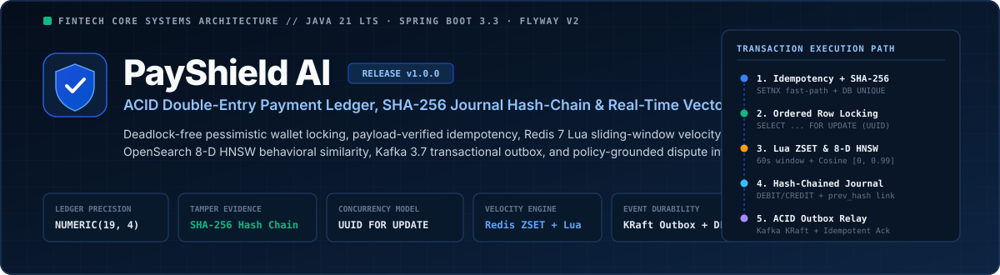

<br/>

[](https://github.com/Shivampal157/PayShield-AI/actions/workflows/ci.yml)
-0A2540?style=flat-square&logo=openjdk&logoColor=white)

_%2B_SHA256-336791?style=flat-square&logo=postgresql&logoColor=white)


[
<br/><br/>
<a href="https://payshield-ai-lezr.onrender.com" target="_blank">
  
</a>
<br/><br/>
[](https://render.com/deploy?repo=https://github.com/Shivampal157/PayShield-AI)

<p align="center">
  <a href="#architectural-guarantees">Guarantees</a> ·
  <a href="#system-topology--execution-protocol">Architecture</a> ·
  <a href="#subsystem-walkthrough">Subsystem Tour</a> ·
  <a href="#architecture-decision-records">ADRs</a> ·
  <a href="#failure-modes--degraded-operation">Failure Modes</a> ·
  <a href="#local-execution">Setup</a> ·
  <a href="#http-api--wire-protocol">API Contract</a> ·
  <a href="#verification-suite">Verification</a>
</p>

</div>

---

> [!IMPORTANT]
> **Simulation Scope:** PayShield AI is a reference FinTech backend and operator console engineered for distributed-systems architecture evaluation. All balances are simulated `NUMERIC(19,4)` ledger entries; it does not move real funds, integrate with card networks, or claim calibrated production ML fraud probabilities.
>
> 🚀 **Live Cloud Deployment:** [https://payshield-ai-lezr.onrender.com](https://payshield-ai-lezr.onrender.com)  
> 📑 **Interactive Swagger / OpenAPI:** [https://payshield-ai-lezr.onrender.com/swagger-ui.html](https://payshield-ai-lezr.onrender.com/swagger-ui.html)  
> 🩺 **Actuator Health Probe:** [https://payshield-ai-lezr.onrender.com/actuator/health](https://payshield-ai-lezr.onrender.com/actuator/health)  
> 🔑 **Instant Sign-In:** Click the demo buttons on the login portal, or use `elena.rostova@payshield.demo` / `demo123` (Analyst), `alice.morgan@payshield.demo` / `demo123` (Customer).

---

## Architectural Guarantees

PayShield AI models the core correctness, concurrency, and auditability invariants required by a multi-currency payment ledger and pre-settlement risk engine:

<p align="center">
  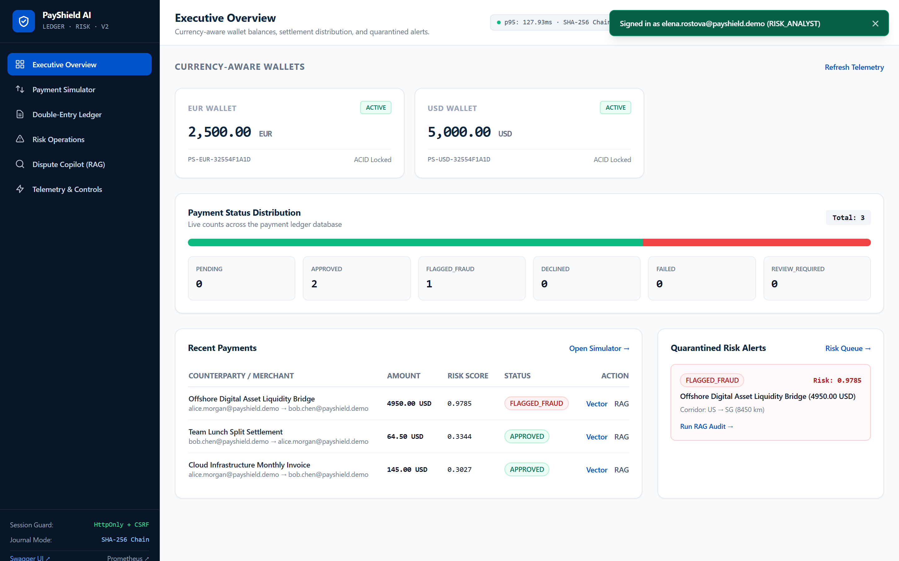
  <br/>
  <sub><strong>Executive Console:</strong> Multi-currency <code>NUMERIC(19,4)</code> wallet state, settlement distribution across ledger statuses, live Micrometer <code>p95</code> header telemetry, and quarantined transfers awaiting analyst disposition.</sub>
</p>

| Subsystem | Enforced Invariant | Implementation Mechanism |
| :--- | :--- | :--- |
| **Monetary Representation** | Zero floating-point rounding drift across balances and journals | `BigDecimal` (`scale = 4`, `HALF_UP`) mapped to PostgreSQL `NUMERIC(19, 4)` with `CHECK (balance >= 0)` |
| **Concurrent Settlement** | No lost updates, negative balances, or bidirectional deadlocks | Deterministic ascending **UUID-ordered `SELECT ... FOR UPDATE`** row locks paired with JPA `@Version` |
| **Tamper-Evident Journal** | Unauthorized SQL edits to historical ledger rows are detectable | Per-wallet monotonic `wallet_sequence` + **SHA-256 hash chain** (`previous_hash` $\rightarrow$ `entry_hash`) verified during reconciliation |
| **Idempotency** | Retried requests never double-debit; mutated retries fail closed | Fast-path Redis `SETNX` coordination + DB `UNIQUE(sender_wallet_id, idempotency_key)` + canonical **SHA-256 payload hash** (`409 Conflict` on mismatch) |
| **Pre-Settlement Risk Gate** | Suspicious transfers cannot drain funds prior to review | `FLAGGED_FRAUD` and `REVIEW_REQUIRED` quarantine the transaction before posting `DEBIT`/`CREDIT` rows |
| **Sliding-Window Velocity** | Sub-minute burst protection without fixed-window boundary spikes | Atomic **Redis 7 Sorted Set (`ZSET`) Lua script** (`<= 5` attempts per rolling `60s` window) + concurrent local fallback |
| **Event Durability** | No dual-write inconsistency between PostgreSQL and Kafka | **Transactional Outbox** (`outbox_events`) committed in the same DB transaction + `3x` exponential backoff + `.DLT` + idempotent consumer PK table |
| **Session & Browser Auth** | Resilient against token theft, replay, and cross-site request forgery | `BCrypt(12)` + short-lived JWT in `HttpOnly` cookie + **Double-Submit CSRF (`X-CSRF-Token`)** + **Refresh-Token Family Reuse Revocation** |

---

## System Topology & Execution Protocol

### 1. Service & Data Plane Topology

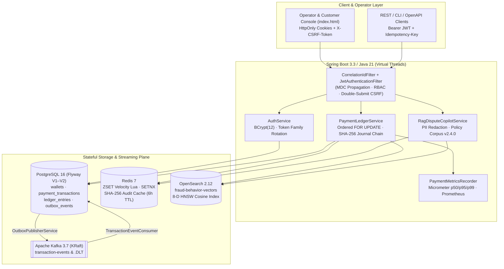

### 2. Lock-Ordered Payment & Pre-Settlement Quarantine Sequence

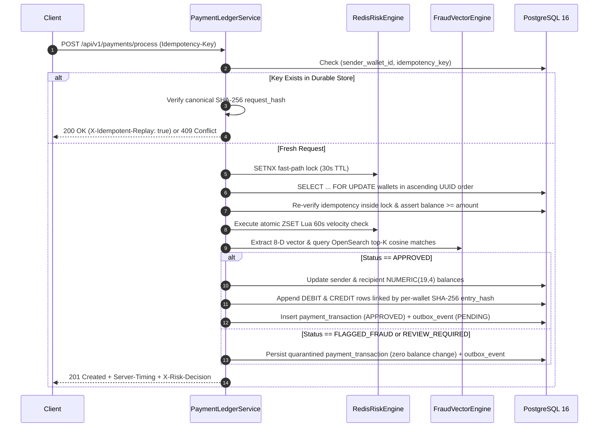

### 3. Transaction Settlement Lifecycle

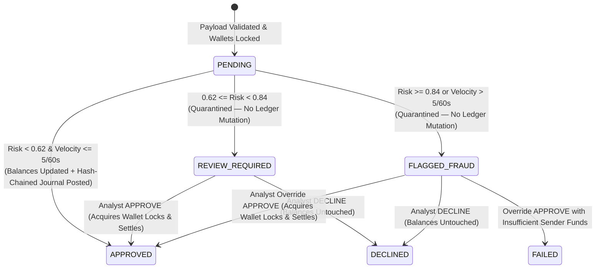

---

## Subsystem Walkthrough

### 1. Authentication, Token-Family Rotation & RBAC

<p align="center">
  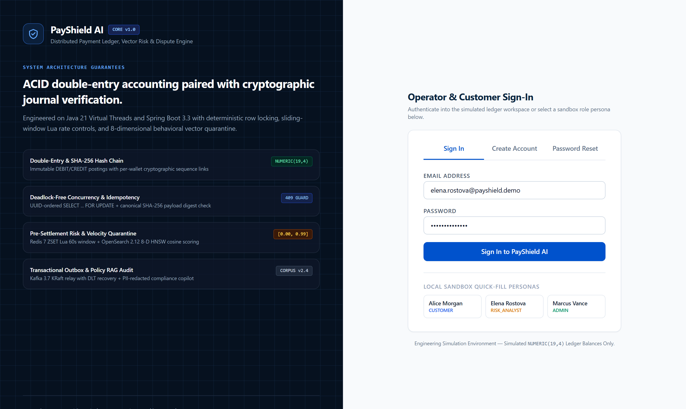
  <br/>
  <sub><strong>Authentication Console:</strong> Institutional split-pane sign-in, customer wallet provisioning (<code>USD</code>/<code>EUR</code>/<code>GBP</code>), single-use password reset, and sandbox role personas (<code>CUSTOMER</code>, <code>RISK_ANALYST</code>, <code>ADMIN</code>).</sub>
</p>

- **Hashed Credential & Token Storage:** Passwords use `BCryptPasswordEncoder(12)`. Refresh tokens and password-reset tokens are generated from 256-bit `SecureRandom` entropy and stored exclusively as SHA-256 hex digests (`refresh_tokens.token_hash`).
- **Refresh-Token Family Reuse Detection:** Every login creates a `family_id`. Token rotation (`POST /api/v1/auth/refresh`) marks the prior token `revoked = true` and records `replaced_by_token_hash`. Presenting an already-rotated token triggers immediate revocation of the entire `family_id` and writes a `REFRESH_TOKEN_REUSE_DETECTED` audit record.
- **Browser CSRF + Stateless CLI Support:** Browser requests authenticate via `HttpOnly`, `SameSite=Lax` cookies guarded by double-submit CSRF verification (`X-CSRF-Token` must match `ps_csrf_token` on state-changing verbs). API clients can pass `Authorization: Bearer <jwt>` without cookie state.

---

### 2. Payment Execution, Wire Protocol & Sliding-Window Velocity

<p align="center">
  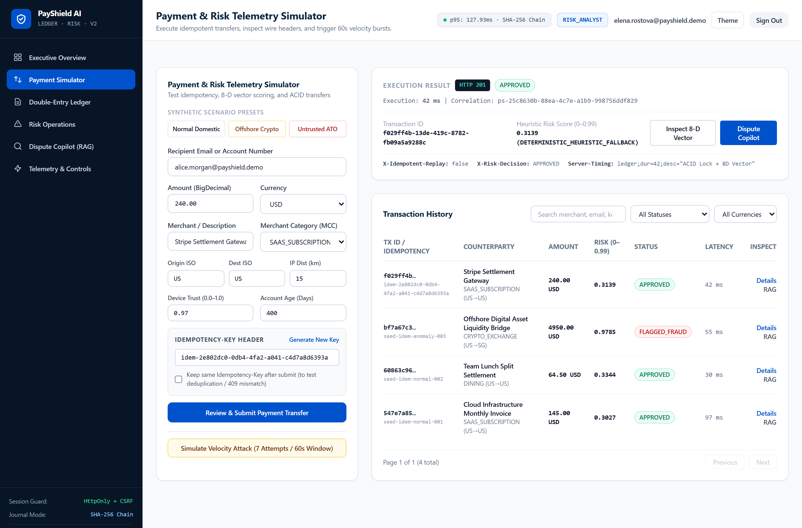
  <br/>
  <sub><strong>Payment &amp; Risk Simulator:</strong> Synthetic corridor/MCC presets, <code>Idempotency-Key</code> replay and <code>409</code> mismatch testing, 7-transfer velocity burst trigger, and live HTTP response header trace (<code>HTTP 201</code>, <code>X-Idempotent-Replay</code>, <code>X-Risk-Decision</code>, <code>Server-Timing</code>).</sub>
</p>

- **Two-Tier Idempotency:** Each transfer hashes `(recipientWalletId, amount, currency, merchantName, merchantCategory, sourceCountry, destinationCountry)` with SHA-256. Replaying an existing `(sender_wallet_id, idempotency_key)` with the identical payload returns `200 OK` (`X-Idempotent-Replay: true`) without re-executing ledger mutations; altering any parameter returns `409 Conflict` (`urn:payshield:error:idempotency-payload-mismatch`).
- **Redis 7 ZSET Lua Velocity Script:** Enforces a rolling 60-second window atomically inside Redis (`ZREMRANGEBYSCORE` $\rightarrow$ `ZADD` $\rightarrow$ `ZCARD` $\rightarrow$ `PEXPIRE`), preventing the $2\times$ boundary burst allowed by fixed-minute counters.

---

### 3. Double-Entry Ledger & Per-Wallet SHA-256 Hash Chain

<p align="center">
  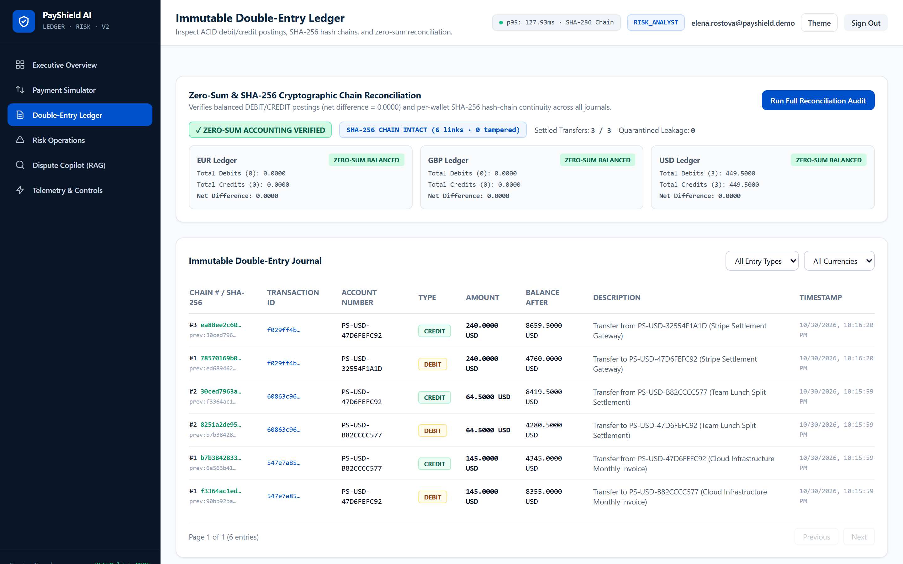
  <br/>
  <sub><strong>Immutable Journal &amp; Cryptographic Reconciliation:</strong> Verifies both zero-sum accounting (<code>SUM(DEBIT) == SUM(CREDIT)</code>) across <code>USD</code>, <code>EUR</code>, and <code>GBP</code> and monotonic per-wallet SHA-256 hash-chain continuity.</sub>
</p>

Standard zero-sum checks (`SUM(DEBIT) - SUM(CREDIT) == 0`) cannot detect an attacker with raw database access who alters `balance_after` or modifies a `DEBIT` and `CREDIT` pair by the same delta. PayShield AI (Flyway `V2`) chains every `LedgerEntry` within its wallet partition while holding the wallet's `SELECT ... FOR UPDATE` row lock:

$$\text{entry\_hash}_n = \operatorname{SHA256}\!\left(\texttt{v1}|\text{seq}_n|\text{entry\_hash}_{n-1}|\text{tx\_id}|\text{wallet\_id}|\text{type}|\text{amount}|\text{currency}|\text{balance\_after}|\text{ts\_ms}\right)$$

Calling `GET /api/v1/ledger/reconciliation` recomputes every chain from `GENESIS_V1|<walletId>` and flags `cryptographicHashChainIntact = false` if any historical column was mutated out-of-band.

---

### 4. 8-D Behavioral Vector Engine & Risk Operations

<p align="center">
  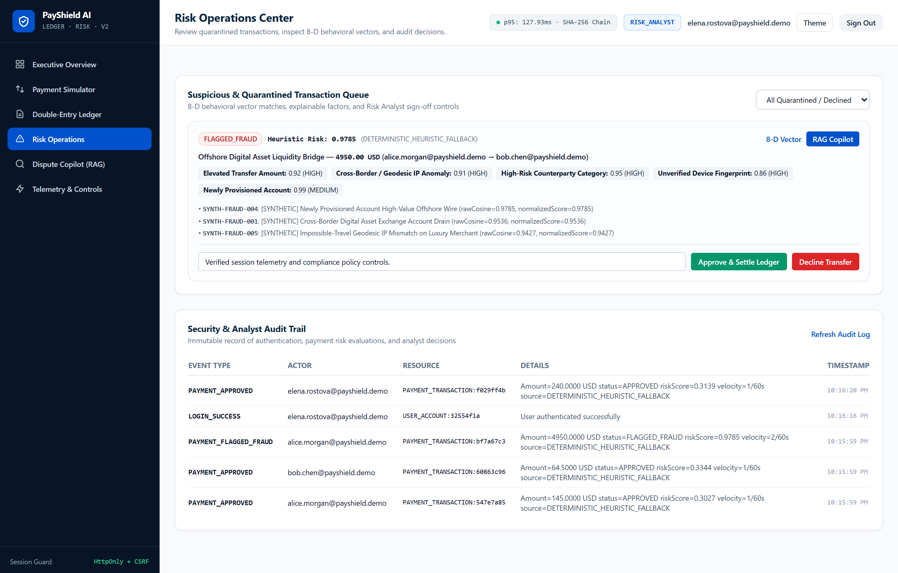
  <br/>
  <sub><strong>Risk Operations Center:</strong> Quarantined transfer queue with explainable risk factor severities, OpenSearch top-K <code>SYNTH-FRAUD-*</code> similarity matches, analyst settlement sign-off, and the immutable <code>SecurityAuditLog</code> stream.</sub>
</p>

<p align="center">
  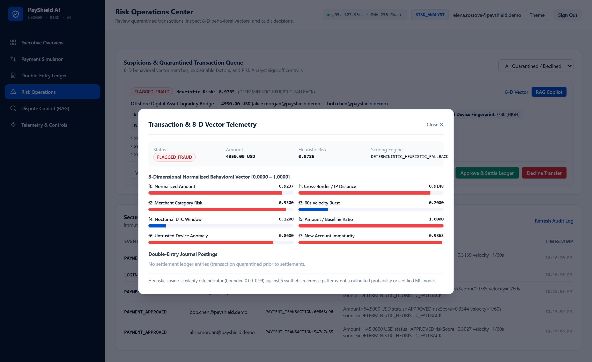
  <br/>
  <sub><strong>8-D Behavioral Vector Inspector:</strong> Per-dimension normalized telemetry (<code>f0</code>–<code>f7</code> in <code>[0.0000, 1.0000]</code>) and magnitude-attenuated similarity score.</sub>
</p>

Each payment is projected into an 8-dimensional normalized vector $\mathbf{q} \in [0, 1]^8$ and evaluated against the OpenSearch 2.12 HNSW index `fraud-behavior-vectors`:

| Index | Feature | Normalization | Signal |
| :---: | :--- | :--- | :--- |
| `f0` | `f0_normalizedAmount` | `min(1.0, log10(1 + amount) / log10(10001))` | Log-scaled transfer magnitude |
| `f1` | `f1_crossBorderIpAnomaly` | `(src != dst ? 0.45 : 0) + min(0.55, ipKm / 10000 * 0.55)` | Cross-border corridor & geodesic IP distance |
| `f2` | `f2_merchantRiskCategory` | Tiered MCC weight (`0.10` SaaS/Grocery $\rightarrow$ `0.95` Crypto) | Counterparty category risk profile |
| `f3` | `f3_velocityBurstScore` | `clamp((velocityCount - 1) / 5.0, 0, 1)` | Rolling 60-second transfer frequency |
| `f4` | `f4_nocturnalTimeOfDayRisk` | `0.85` (`00–04 UTC`), `0.48` (transition), `0.12` (daytime) | Off-hours nocturnal execution window |
| `f5` | `f5_amountToBaselineRatio` | `clamp((amount / 250.0) / 12.0, 0, 1)` | Multiplier over baseline retail transfer size |
| `f6` | `f6_untrustedDeviceAnomaly` | `clamp(1.0 - deviceTrustScore, 0, 1)` | Session / device fingerprint untrusted score |
| `f7` | `f7_newAccountImmaturity` | `clamp(1.0 - min(1.0, accountAgeDays / 365.0), 0, 1)` | Newly created account mule indicator |

To prevent low-magnitude domestic vectors from scoring high solely due to directional alignment with a high-risk octant, raw cosine similarity is attenuated by L2 norm ratio and capped strictly in `[0.00, 0.99]`:

$$\operatorname{Score}(\mathbf{q}, \mathbf{r}) = \min\!\left(0.99,\; \max(0, \cos\theta)\cdot\left(0.35 + 0.65\cdot\min\!\left(1.0, \frac{\lVert\mathbf{q}\rVert_2}{\lVert\mathbf{r}\rVert_2}\right)\right)\right)$$

---

### 5. Retrieval-Augmented Dispute Investigation (RAG)

<p align="center">
  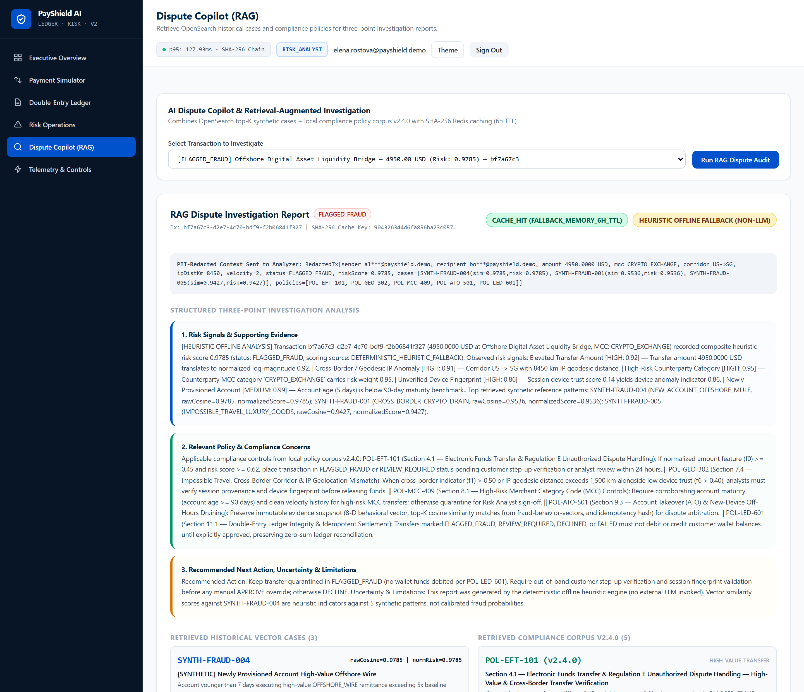
  <br/>
  <sub><strong>Dispute Investigation Copilot:</strong> Displays Redis SHA-256 <code>CACHE_HIT</code> status, explicit <code>HEURISTIC OFFLINE FALLBACK</code> vs. LLM provenance badge, PII-redacted analyzer context, structured 3-point analysis, and retrieved <code>SYNTH-FRAUD-*</code> + <code>POL-*</code> evidence cards.</sub>
</p>

- **Grounded Evidence & Policy Retrieval:** Combines top-K similar cases from OpenSearch (`SYNTH-FRAUD-001`..`005`) with applicable sections from the versioned local compliance corpus (`src/main/resources/policies/compliance-policies-v2.4.json`, `POL-EFT-101` through `POL-LED-601`).
- **PII Redaction & Provider Isolation:** Masks counterparty emails (`al***@payshield.demo`) and strips internal wallet UUIDs before invoking external `OPENAI_COMPATIBLE` or `GEMINI` adapters. When `AI_PROVIDER=OFFLINE` (default) or an upstream LLM errors out, `RagDisputeCopilotService` produces a deterministic heuristic report explicitly labeled `llmGenerated: false`.
- **Context-Sensitive SHA-256 Caching:** Reports are cached for 6 hours under `SHA256(txId | status | riskScore | analystDecision | policyCorpusVersion | provider)`. Analyst approval or decline invalidates the Redis entry so stale pre-review reports are never served.

---

### 6. Micrometer Percentiles, Actuator Health & Outbox DLT Control

<p align="center">
  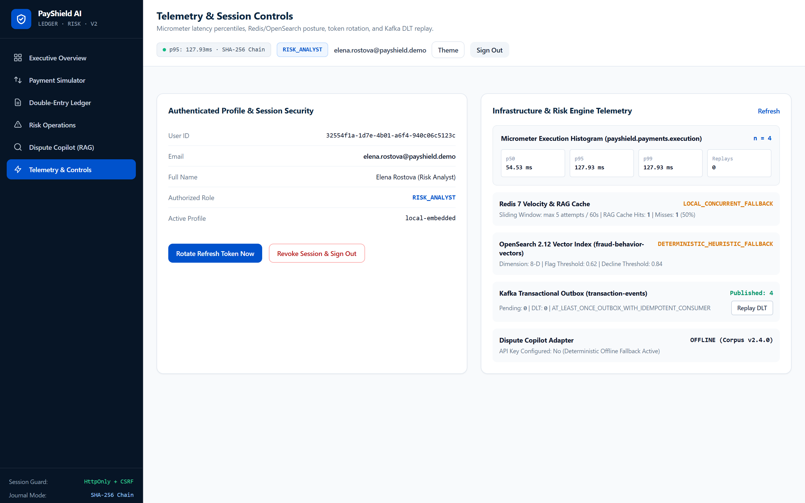
  <br/>
  <sub><strong>Telemetry &amp; Session Controls:</strong> Live Micrometer execution latency percentiles (<code>p50</code>, <code>p95</code>, <code>p99</code>), Redis cache hit ratios, OpenSearch index posture, refresh-token rotation, and operator Dead-Letter Outbox (DLT) replay.</sub>
</p>

- **Domain Metrics (`PaymentMetricsRecorder`):** Publishes `payshield.payments.execution` (`0.50`, `0.95`, `0.99` percentiles), `payshield.payments.decisions.total`, `payshield.payments.idempotent_replays.total`, `payshield.risk.velocity_breaches.total`, and `payshield.outbox.backlog.events` gauges to `/actuator/prometheus`.
- **Custom Health Indicator (`PayShieldPlatformHealthIndicator`):** Surfaces journal hash-chain mode, degraded risk-engine state, and outbox DLT counts under `/actuator/health`.

---

## Architecture Decision Records

| ADR | Decision | Context & Trade-off |
| :--- | :--- | :--- |
| **ADR-01** | **UUID-ordered `SELECT ... FOR UPDATE` over DB-wide `SERIALIZABLE`** | PostgreSQL `SERIALIZABLE` SSI aborts contending transactions with `40001` serialization failures, forcing noisy client retries on hot merchant wallets. Acquiring row locks in deterministic ascending `UUID` order serializes only contending wallet pairs with zero deadlock cycles. |
| **ADR-02** | **Per-wallet SHA-256 hash chain over a single global ledger sequence** | A global monotonic sequence across all `ledger_entries` creates a single-row serialization bottleneck on every transfer. Partitioning the SHA-256 chain per `wallet_id` piggybacks on the wallet row lock already held during settlement—achieving full tamper evidence with zero cross-wallet contention. |
| **ADR-03** | **Pre-settlement fraud quarantine over async post-settlement reversal** | Settling funds immediately and reversing flagged transfers asynchronously exposes the ledger to irreversible balance drain if the recipient withdraws funds first. High-risk transfers (`>= 0.62`) persist in `REVIEW_REQUIRED` / `FLAGGED_FRAUD` with zero ledger postings until an authorized analyst approves under lock. |
| **ADR-04** | **Transactional Outbox + Idempotent Consumer over distributed XA** | Two-phase commit across PostgreSQL and Kafka degrades throughput and availability. Writing `outbox_events` in the local ACID transaction guarantees event persistence; `ProcessedKafkaEvent` (`event_id` PK) deduplicates at-least-once relay deliveries. |
| **ADR-05** | **Dual-layer Idempotency (`SETNX` + DB `UNIQUE` + SHA-256 digest)** | Relying solely on Redis `SETNX` loses correctness upon cache eviction or failover. Redis acts purely as a fast-path coordinator while `UNIQUE(sender_wallet_id, idempotency_key)` inside the pessimistic wallet lock enforces durability. |

---

## Failure Modes & Degraded Operation

PayShield AI is designed to start and process transfers safely even when auxiliary infrastructure is unreachable:

| Dependency Outage | Runtime Detection | Degraded Behavior | Correctness Impact |
| :--- | :--- | :--- | :--- |
| **Redis 7 Unreachable** | `RedisConnectionFailureException` / command timeout (`1.5s`) | Velocity engine switches to a lock-striped `ConcurrentHashMap` sliding window; idempotency falls through to PostgreSQL `UNIQUE` + `FOR UPDATE`; RAG cache uses bounded local TTL memory | Single-node velocity & cache scope; **zero loss of ledger or idempotency correctness** |
| **OpenSearch 2.12 Offline** | HTTP socket timeout or non-2xx on `/fraud-behavior-vectors/_search` | `FraudVectorEngine` computes exact 8-D cosine similarity in-memory against the 5 reference patterns (`scoringSource = DETERMINISTIC_HEURISTIC_FALLBACK`) | Identical mathematical scoring on seeded patterns; flagged in `/api/v1/risk/metrics` |
| **Kafka 3.7 Broker Down** | `KafkaTemplate.send()` timeout (`1.5s`) | `OutboxEvent` stays durable in PostgreSQL; retries `3x` with exponential backoff ($2^n\text{s}$), transitions to `DEAD_LETTER`, and can be replayed via `POST /api/v1/risk/outbox/replay-dlt` | Eventual downstream delivery; committed ledger balances remain unaffected |
| **External LLM Timeout / 5xx** | `HttpClient` timeout (`10s`) or missing `AI_API_KEY` | `RagDisputeCopilotService` falls back to the deterministic policy-citation synthesizer and badges output as `HEURISTIC_OFFLINE_FALLBACK` (`llmGenerated: false`) | Zero fabricated citations; full availability without external secrets |

---

## Local Execution

### Prerequisites
- **JDK 21+** (Eclipse Temurin / OpenJDK 21)
- **Maven Wrapper** (`./mvnw` / `.\mvnw.cmd` included in repository)
- **Docker Compose** *(Required only for Mode A; Mode B runs standalone with zero external daemons)*

### Mode A — Full Distributed Stack (PostgreSQL 16 + Redis 7 + Kafka 3.7 KRaft + OpenSearch 2.12)

```bash
cp .env.example .env
docker compose up --build -d
docker compose ps
curl -s http://localhost:8080/actuator/health
```

### Mode B — Zero-Daemon Embedded Runtime (`local-embedded`)

Starts immediately on any workstation without Docker using H2 (`MODE=PostgreSQL`), Flyway migrations `V1`–`V2`, and deterministic in-process adapters:

```bash
# Linux / macOS
./mvnw clean package -DskipTests
java -jar target/payshield-ai-1.0.0.jar --spring.profiles.active=local-embedded
```

```powershell
# Windows PowerShell
.\mvnw.cmd clean package -DskipTests
java -jar target\payshield-ai-1.0.0.jar --spring.profiles.active=local-embedded
```

### Local Interfaces & Sandbox Credentials

| Endpoint | URL | Notes |
| :--- | :--- | :--- |
| **Web Console** | `http://localhost:8080/` | Responsive operator & customer SPA |
| **Swagger UI** | `http://localhost:8080/swagger-ui.html` | Interactive OpenAPI 3.0 explorer |
| **Prometheus Metrics** | `http://localhost:8080/actuator/prometheus` | Micrometer scrape endpoint |
| **Health Probe** | `http://localhost:8080/actuator/health` | Liveness, readiness & `payshieldPlatform` posture |

Sandbox accounts seeded automatically **only** when `payshield.security.demo-seed-enabled=true` (`local`, `local-embedded`, `test`; disabled in `production`):
- `alice.morgan@payshield.demo` / `PayShieldDemo1` — `CUSTOMER` (`$8,500.00 USD`, `€2,500.00 EUR`)
- `bob.chen@payshield.demo` / `PayShieldDemo1` — `CUSTOMER` (`$4,200.00 USD`, `€2,500.00 EUR`)
- `elena.rostova@payshield.demo` / `PayShieldDemo1` — `RISK_ANALYST` (Queue review, reconciliation, DLT replay, audit log)
- `marcus.vance@payshield.demo` / `PayShieldDemo1` — `ADMIN` (Full administrative privileges)

---

## HTTP API & Wire Protocol

<p align="center">
  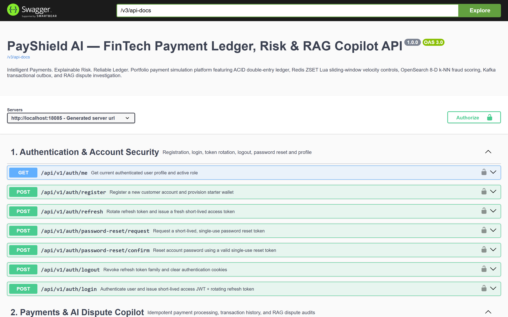
  <br/>
  <sub><strong>OpenAPI 3.0 Specification (<code>/swagger-ui.html</code>):</strong> 22 endpoints across Authentication, Idempotent Payments, Hash-Chained Ledger, Risk Operations, Outbox DLT Replay, and Dispute Investigation.</sub>
</p>

### Endpoint Summary (22 Endpoints)

| Group | Method & Path | Access | Description |
| :--- | :--- | :--- | :--- |
| **Auth** | `POST /api/v1/auth/register` | Public | Provisions `CUSTOMER` account and initial currency wallet |
| **Auth** | `POST /api/v1/auth/login` | Public | Rate-limited BCrypt login; issues `HttpOnly` JWT + CSRF cookies |
| **Auth** | `POST /api/v1/auth/refresh` | Public (Token) | Rotates refresh token; revokes token family if reuse is detected |
| **Auth** | `POST /api/v1/auth/logout` | Authenticated | Revokes active refresh-token family and clears cookies |
| **Auth** | `GET /api/v1/auth/me` | Authenticated | Returns principal identity, role, and active environment |
| **Auth** | `POST /api/v1/auth/password-reset/request` | Public | Issues single-use 15-minute reset token via `LocalDevEmailAdapter` |
| **Auth** | `POST /api/v1/auth/password-reset/confirm` | Public | Consumes reset token, updates password, and revokes sessions |
| **Payments** | `POST /api/v1/payments/process` | Authenticated | Executes idempotent transfer; emits `X-Idempotent-Replay`, `X-Risk-Decision`, `Server-Timing` |
| **Payments** | `GET /api/v1/payments` | Authenticated | Paginated, sortable, filterable transaction query |
| **Payments** | `GET /api/v1/payments/overview` | Authenticated | Wallet balances, status distribution, and quarantined alerts |
| **Payments** | `GET /api/v1/payments/{id}` | Owner / Analyst | Full payment record, 8-D vector, risk factors, and journal rows |
| **Disputes** | `POST /api/v1/payments/{id}/dispute-rag-audit` | Owner / Analyst | Generates or serves SHA-256 cached 3-point RAG dispute report |
| **Wallets** | `GET /api/v1/wallets/me` | Authenticated | Caller's currency-aware wallets and `NUMERIC(19,4)` balances |
| **Wallets** | `GET /api/v1/wallets/directory` | Authenticated | Counterparty account directory for simulator transfers |
| **Ledger** | `GET /api/v1/ledger` | Authenticated | Paginated immutable `DEBIT` / `CREDIT` rows with SHA-256 chain metadata |
| **Ledger** | `GET /api/v1/ledger/reconciliation` | `RISK_ANALYST` / `ADMIN` | Audits zero-sum currency totals and per-wallet SHA-256 hash-chain integrity |
| **Risk Ops** | `GET /api/v1/risk/transactions` | Authenticated | Quarantined `FLAGGED_FRAUD` & `REVIEW_REQUIRED` queue |
| **Risk Ops** | `POST /api/v1/risk/transactions/{id}/review` | `RISK_ANALYST` / `ADMIN` | `APPROVE` (settles ledger under lock) or `DECLINE` with mandatory notes |
| **Risk Ops** | `POST /api/v1/risk/simulate-velocity` | Authenticated | Executes 7 rapid transfers to verify `>5/60s` sliding-window limit |
| **Risk Ops** | `GET /api/v1/risk/metrics` | Authenticated | Micrometer `p50`/`p95`/`p99` latencies, Redis hit rate, OpenSearch & Outbox counters |
| **Risk Ops** | `POST /api/v1/risk/outbox/replay-dlt` | `RISK_ANALYST` / `ADMIN` | Re-queues `DEAD_LETTER` outbox events to `PENDING` and triggers relay |
| **Audit** | `GET /api/v1/audit` | `RISK_ANALYST` / `ADMIN` | Paginated `SecurityAuditLog` records with `X-Correlation-Id` lineage |

<details>
<summary><strong>Wire-Level cURL Verification Commands</strong></summary>

<br/>

```bash
# 1. Obtain short-lived access JWT
TOKEN=$(curl -s -X POST http://localhost:8080/api/v1/auth/login \
  -H "Content-Type: application/json" \
  -d '{"email":"alice.morgan@payshield.demo","password":"PayShieldDemo1"}' \
  | jq -r '.accessToken')

# 2. Execute idempotent transfer and inspect HTTP wire headers (201 Created, X-Idempotent-Replay: false, Server-Timing)
curl -i -s -X POST http://localhost:8080/api/v1/payments/process \
  -H "Authorization: Bearer $TOKEN" \
  -H "Idempotency-Key: idem-wire-001" \
  -H "Content-Type: application/json" \
  -d '{
    "recipientIdentifier": "bob.chen@payshield.demo",
    "amount": 125.50,
    "currency": "USD",
    "merchantName": "Cloud Infrastructure Settlement",
    "merchantCategory": "SAAS_SUBSCRIPTION",
    "sourceCountry": "US",
    "destinationCountry": "US",
    "ipDistanceKm": 18.0,
    "deviceTrustScore": 0.97,
    "accountAgeDays": 400
  }' | grep -E "HTTP/|X-Idempotent-Replay|X-Risk-Decision|X-Correlation-Id|Server-Timing"

# 3. Replay identical request -> HTTP 200 OK, X-Idempotent-Replay: true (zero duplicate debit)
curl -i -s -X POST http://localhost:8080/api/v1/payments/process \
  -H "Authorization: Bearer $TOKEN" \
  -H "Idempotency-Key: idem-wire-001" \
  -H "Content-Type: application/json" \
  -d '{
    "recipientIdentifier": "bob.chen@payshield.demo",
    "amount": 125.50,
    "currency": "USD",
    "merchantName": "Cloud Infrastructure Settlement",
    "merchantCategory": "SAAS_SUBSCRIPTION",
    "sourceCountry": "US",
    "destinationCountry": "US",
    "ipDistanceKm": 18.0,
    "deviceTrustScore": 0.97,
    "accountAgeDays": 400
  }' | grep -E "HTTP/|X-Idempotent-Replay"

# 4. Verify global zero-sum accounting + SHA-256 cryptographic hash-chain integrity as Risk Analyst
ANALYST_TOKEN=$(curl -s -X POST http://localhost:8080/api/v1/auth/login \
  -H "Content-Type: application/json" \
  -d '{"email":"elena.rostova@payshield.demo","password":"PayShieldDemo1"}' \
  | jq -r '.accessToken')

curl -s http://localhost:8080/api/v1/ledger/reconciliation \
  -H "Authorization: Bearer $ANALYST_TOKEN" \
  | jq '{overallBalanced, cryptographicHashChainIntact, verifiedHashChainEntries, brokenHashChainLinks}'
```

</details>

---

## Verification Suite

Run the full 23-test unit, concurrency, cryptographic tamper-detection, and security integration suite:

```bash
./mvnw clean verify
```

| Test Class | Count | Verified Properties |
| :--- | :---: | :--- |
| `AuthAndSecurityIntegrationTest` | `5` | Registration & starter wallet provisioning; password policy validation; expired JWT rejection (`401`); refresh-token rotation & **family-wide revocation on token replay**; double-submit CSRF enforcement (`403` vs `200`); single-use password reset; `CUSTOMER` / `RISK_ANALYST` / `ADMIN` RBAC boundaries |
| `PaymentLedgerAndConcurrencyIntegrationTest` | `3` | `Idempotency-Key` replay deduplication (`200 OK`) & mutated payload rejection (`409`); **8-thread concurrent overspend barrier test** (`8 x $600` against `$1,500` wallet $\rightarrow$ 2 settle, 6 fail `422 INSUFFICIENT_FUNDS`, final balance `$300.0000`, zero-sum balanced); pre-settlement fraud quarantine $\rightarrow$ RAG `CACHE_MISS`/`CACHE_HIT` $\rightarrow$ analyst settlement & cache invalidation |
| `LedgerIntegrityAndObservabilityIntegrationTest` | `5` | Monotonic per-wallet SHA-256 hash-chain linking; **direct SQL ledger tampering detection** (`UPDATE ledger_entries` caught by SHA-256 digest audit); `X-Idempotent-Replay`, `X-Risk-Decision`, `Server-Timing`, and RFC 9457 `urn:payshield:error:*` wire semantics; Micrometer `p50`/`p95`/`p99` histograms & Actuator health; RBAC-guarded DLT outbox replay |
| `FraudVectorEngineTest` | `5` | 8-D feature normalization in `[0.0, 1.0]`; magnitude-attenuated cosine score bounds `[0.00, 0.99]`; low-risk domestic approval; high-risk offshore crypto quarantine; OpenSearch offline & empty-index deterministic fallbacks |
| `RedisRiskEngineTest` | `3` | Redis Lua `ZSET` sliding-window boundary (`1..5` allowed, `6th` flagged); 10-thread concurrent fallback under simulated Redis failure; SHA-256 RAG cache hit/miss tracking & invalidation |
| `KafkaOutboxAndConsumerTest` | `2` | Consumer duplicate-event suppression via `processed_kafka_events`; outbox 3-attempt exponential backoff, `DEAD_LETTER` transition, and replay recovery |

---

## Repository Layout & Configuration

<details>
<summary><strong>Source Tree</strong></summary>

<br/>

```text
payshield-ai/
├── .env.example
├── .gitattributes
├── .gitignore
├── Dockerfile
├── docker-compose.yml
├── mvnw / mvnw.cmd
├── pom.xml
├── README.md
├── docs/
│   ├── assets/payshield-banner.svg
│   └── screenshots/01-auth-portal.png .. 09-swagger-openapi.png
├── .github/workflows/ci.yml
└── src/
    ├── main/
    │   ├── java/com/payshield/
    │   │   ├── config/          # AppProperties, SecurityConfig, KafkaConfig, OpenApiConfig, CorrelationIdFilter, PayShieldPlatformHealthIndicator, BootstrapInitializer
    │   │   ├── controller/      # AuthController, PaymentController, WalletLedgerController, RiskController
    │   │   ├── domain/          # UserAccount, Wallet, PaymentTransaction, LedgerEntry (SHA-256 chain), OutboxEvent, ProcessedKafkaEvent, RefreshToken...
    │   │   ├── dto/             # AuthDtos, PaymentLedgerDtos, TransactionEventPayload
    │   │   ├── exception/       # ApiException, GlobalExceptionHandler (RFC 9457 URN problem types)
    │   │   ├── repository/      # 9 JPA Repositories (PESSIMISTIC_WRITE wallet locking & hash-chain head lookup)
    │   │   ├── security/        # AuthenticatedUser, JwtAuthenticationFilter, JwtTokenService
    │   │   ├── service/         # AuthService, PaymentLedgerService, PaymentMetricsRecorder, RedisRiskEngine, FraudVectorEngine, OutboxPublisherService, RagDisputeCopilotService...
    │   │   └── util/            # HashUtils (SHA-256)
    │   └── resources/
    │       ├── application.yml
    │       ├── application-local.yml
    │       ├── application-local-embedded.yml
    │       ├── db/migration/
    │       │   ├── V1__init_payshield_schema.sql
    │       │   └── V2__add_tamper_evident_ledger_hash_chain.sql
    │       ├── policies/compliance-policies-v2.4.json
    │       └── static/index.html
    └── test/
        ├── java/com/payshield/  # 6 JUnit 5 Test Suites (23 tests)
        └── resources/application-test.yml
```

</details>

<details>
<summary><strong>Production Hardening &amp; First-Admin Bootstrap</strong></summary>

<br/>

- **Zero Hardcoded Production Credentials:** In production (`DEMO_SEED_ENABLED=false`), no demo personas are created. Provision the initial administrator once via `BOOTSTRAP_ADMIN_EMAIL` and `BOOTSTRAP_ADMIN_PASSWORD`, verify the `ADMIN_BOOTSTRAPPED` audit entry, and remove those environment variables from the deployment secret store.
- **Unprivileged Container Execution:** `Dockerfile` builds on `eclipse-temurin:21-jdk-alpine` and runs on `eclipse-temurin:21-jre-alpine` as non-root UID/GID `10001` (`payshield:payshield`). `docker-compose.yml` binds PostgreSQL, Redis, Kafka, and OpenSearch ports strictly to `127.0.0.1`.
- **Static CSS Compilation for Production:** Local startup uses Tailwind Play CDN alongside resilient native CSS tokens for zero-Node-toolchain developer onboarding; for strict CSP production deployments without external script origins, precompile utilities into `src/main/resources/static/assets/payshield.min.css`.

</details>

---

<div align="center">
  <sub>PayShield AI · Java 21 LTS, Spring Boot 3.3, PostgreSQL 16, Redis 7, Apache Kafka 3.7, OpenSearch 2.12</sub>
</div>
