<div align="center">

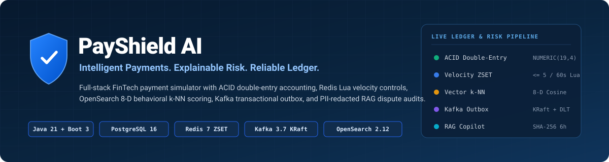

<br/>

[](https://github.com/Shivampal157/PayShield-AI/actions/workflows/ci.yml)


<p align="center">
  <strong>Production-grade FinTech Payment Simulation, ACID Double-Entry Ledger, 8-D Behavioral Vector Fraud Scoring &amp; AI Dispute Investigation Copilot.</strong>
</p>

<p align="center">
  <a href="#-quick-start-60-seconds">Quick Start</a> •
  <a href="#-why-payshield-ai-stands-out">Engineering Tradeoffs</a> •
  <a href="#-system-architecture--flows">Architecture</a> •
  <a href="#-platform-walkthrough--core-engineering-pillars">Live Section Tour</a> •
  <a href="#4-8-d-behavioral-fraud-engine--opensearch-k-nn">8-D Vector Engine</a> •
  <a href="#5-ai-dispute-copilot-rag--context-aware-sha-256-caching">RAG Copilot</a> •
  <a href="#-rest-api-contract-21-endpoints">API &amp; Swagger</a> •
  <a href="#-verified-test-matrix-1818-passing">Tests</a>
</p>

</div>

---

> [!IMPORTANT]
> **Portfolio & Simulation Disclosure:** PayShield AI is an engineering portfolio platform built for technical interviews and distributed-systems demonstrations. It operates strictly on simulated currency-aware ledger balances (`BigDecimal` / `NUMERIC(19,4)`) and is **not** a licensed money transmitter, real-money payment processor, or statistically calibrated/certified production ML fraud model.

---

## ✨ Why PayShield AI Stands Out

<p align="center">
  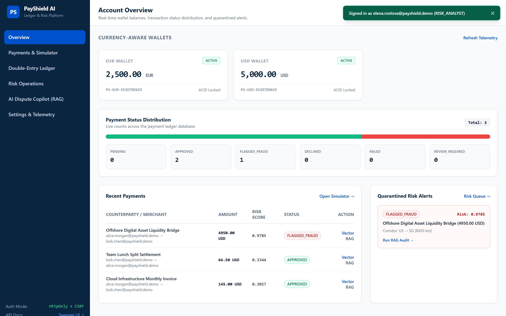
  <br/>
  <sub><strong>Live Executive Overview Console:</strong> Real-time currency-aware <code>NUMERIC(19,4)</code> wallets, proportional transaction status distribution, recent payment telemetry, and quarantined fraud alerts.</sub>
</p>

Most payment portfolio projects stop at `balance = balance - amount` inside a basic CRUD controller. **PayShield AI** implements the actual concurrency, durability, security, and explainability invariants expected in modern FinTech systems:

| Engineering Concern | Typical Tutorial Approach ❌ | PayShield AI Implementation ✅ |
| :--- | :--- | :--- |
| **Monetary Precision** | `double` / `float` arithmetic (silent rounding drift) | Strict Java `BigDecimal` (scale `4`, `HALF_UP`) + PostgreSQL `NUMERIC(19, 4)` + zero-sum reconciliation |
| **Concurrent Transfers** | Unsynchronized read-modify-write (race-condition overspending) | Deterministic **UUID-ordered `SELECT ... FOR UPDATE`** (deadlock-free) + `@Version` optimistic locking |
| **Idempotency** | Ignored, or volatile cache-only key check | Fast-path Redis `SETNX` + durable DB `UNIQUE(sender_wallet_id, idempotency_key)` + **SHA-256 payload mismatch detection (`409 Conflict`)** |
| **Fraud vs. Settlement** | Settles funds first, flags fraud asynchronously (funds already lost) | **Pre-settlement quarantine:** `FLAGGED_FRAUD` & `REVIEW_REQUIRED` hold balance mutation until `RISK_ANALYST` sign-off |
| **Velocity Limiting** | Fixed-minute counter susceptible to boundary bursts | Atomic **Redis 7 Sorted Set (`ZSET`) Lua script** enforcing rolling 60-second sliding windows + concurrent local fallback |
| **Event Reliability** | Dual-write `kafkaTemplate.send()` (lost events on broker crash) | **Transactional Outbox** committed in the same ACID DB transaction + 3x exponential backoff + `.DLT` + idempotent consumer table |
| **Browser Auth & Sessions** | Long-lived JWT in `localStorage` (vulnerable to XSS & replay) | Short-lived JWT (`15m`) in `HttpOnly` cookie + **Double-Submit CSRF (`X-CSRF-Token`)** + **Refresh-Token Family Reuse Revocation** |
| **AI Investigation** | Raw PII sent to an ungrounded LLM prompt | **PII-redacted RAG** citing OpenSearch top-K cases (`SYNTH-FRAUD-*`) & versioned policy corpus (`POL-*`) + SHA-256 Redis cache (`6h` TTL) + deterministic offline fallback |

---

## 🏛️ System Architecture & Flows

### 1. End-to-End Platform Topology

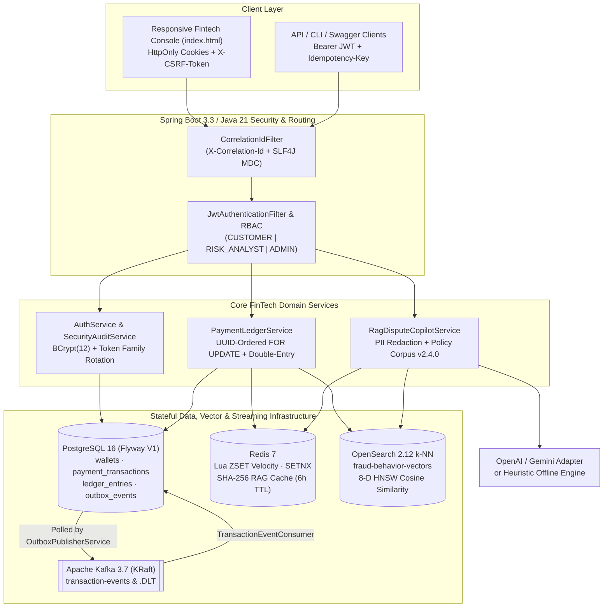

### 2. Idempotent Payment & Atomic Double-Entry Sequence

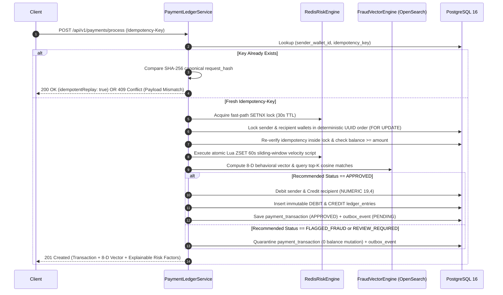

### 3. Payment & Fraud Quarantine State Machine

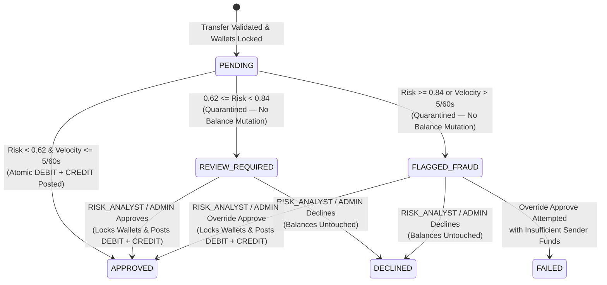

---

## 🖥️ Platform Walkthrough & Core Engineering Pillars

Every module below is served live at `http://localhost:8080/` (`src/main/resources/static/index.html`) backed by real Spring Boot REST APIs, database locks, and risk engines.

### 1. Account Security, RBAC & Refresh-Token Family Protection

<p align="center">
  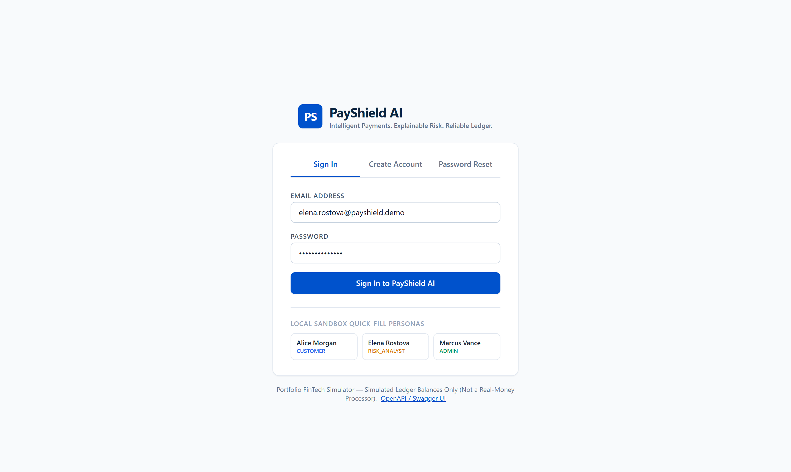
  <br/>
  <sub><strong>Authentication &amp; Sandbox Persona Portal:</strong> Supports customer registration with starter wallet provisioning, single-use password reset, and 1-click sandbox sign-in across <code>CUSTOMER</code>, <code>RISK_ANALYST</code>, and <code>ADMIN</code> roles.</sub>
</p>

- **Cryptographic Hashing:** Passwords hashed with `BCryptPasswordEncoder(12)`; refresh tokens and password-reset tokens are generated via `SecureRandom` (256-bit) and persisted strictly as **SHA-256 hex digests**.
- **Token Reuse Detection:** Every login establishes a `family_id`. Rotating a refresh token (`POST /api/v1/auth/refresh`) marks the old token `revoked = true` and links `replaced_by_token_hash`. If an attacker (or stolen cookie) replays an already-rotated token, `AuthService` immediately revokes **every token in that `family_id`** and logs `REFRESH_TOKEN_REUSE_DETECTED`.
- **Dual-Mode Auth + CSRF Defense:** Browser sessions use `HttpOnly`, `SameSite=Lax` cookies (`ps_access_token`, `ps_refresh_token`) protected by double-submit CSRF validation (`X-CSRF-Token` header must match `ps_csrf_token` on `POST`/`PUT`/`PATCH`/`DELETE`). CLI and service clients can authenticate seamlessly with `Authorization: Bearer <jwt>`.
- **Brute-Force Resilience:** Sliding-window login rate limiting per IP/email + automatic 15-minute account lockout after 5 consecutive failed password attempts.

---

### 2. Payment Simulator, Idempotency & Redis Lua Velocity Control

<p align="center">
  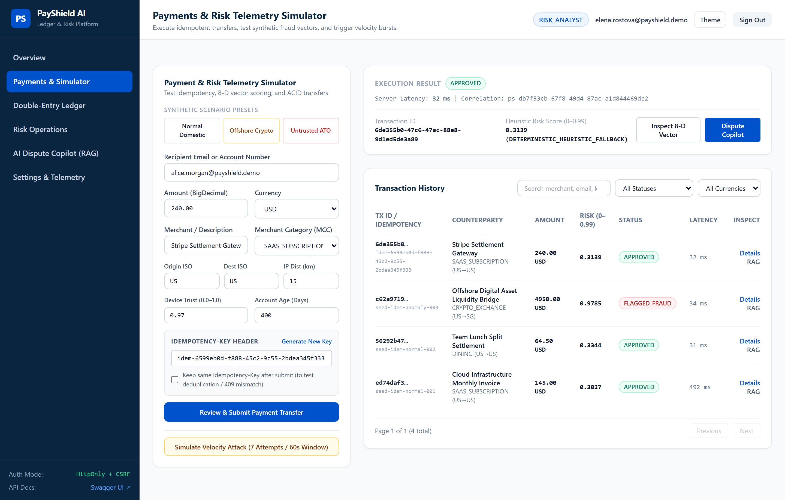
  <br/>
  <sub><strong>Payments &amp; Risk Telemetry Simulator:</strong> Test synthetic fraud presets (<em>Normal Domestic</em>, <em>Offshore Crypto</em>, <em>Untrusted ATO</em>), <code>Idempotency-Key</code> replay &amp; <code>409</code> mismatch protection, server latency readouts, and 7-attempt rolling 60-second velocity attacks.</sub>
</p>

- **Durable Idempotency + Payload Hash Verification:** Each `POST /api/v1/payments/process` call requires an `Idempotency-Key` header. Fast-path Redis `SETNX` prevents duplicate concurrent work while PostgreSQL enforces `UNIQUE (sender_wallet_id, idempotency_key)` alongside a canonical **SHA-256 request payload digest** (`200 OK` replay on identical body; `409 Conflict` on tampered parameters).
- **Atomic Sliding-Window Velocity Limiting:** `RedisRiskEngine` executes a concurrency-safe **Lua script over a Redis Sorted Set (`ZSET`)** (`ZREMRANGEBYSCORE` $\rightarrow$ `ZADD` $\rightarrow$ `ZCARD` $\rightarrow$ `PEXPIRE`) enforcing a default cap of **5 transfers per rolling 60-second window**, automatically degrading to a thread-safe `ConcurrentHashMap` sliding window if Redis is unreachable.

---

### 3. ACID Double-Entry Ledger & Zero-Sum Reconciliation

<p align="center">
  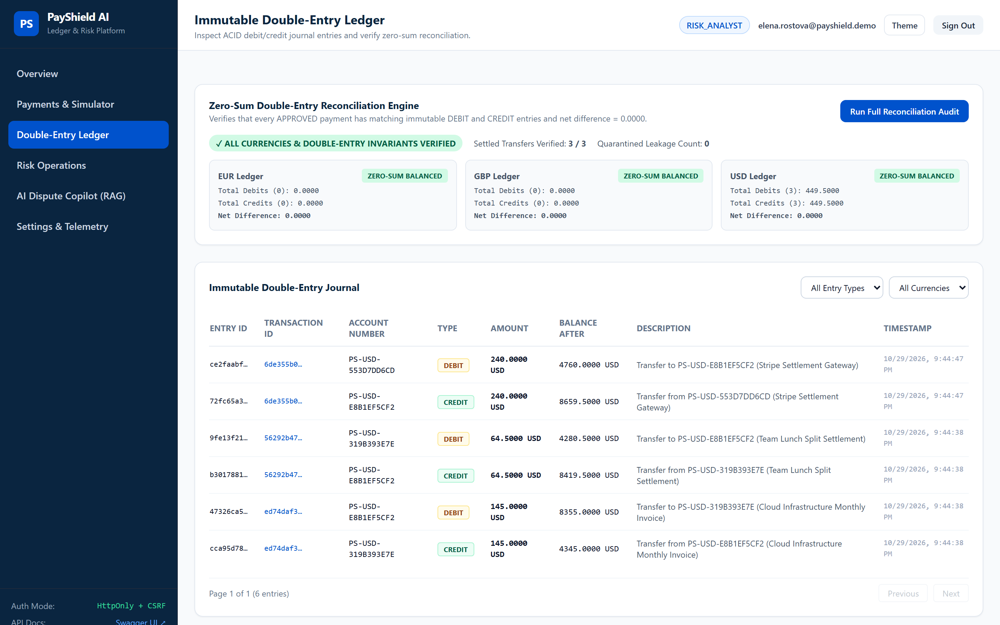
  <br/>
  <sub><strong>Immutable Double-Entry Journal &amp; Zero-Sum Reconciliation:</strong> Every <code>APPROVED</code> payment writes paired <code>DEBIT</code> and <code>CREDIT</code> rows in the same ACID transaction, verified live across <code>EUR</code>, <code>GBP</code>, and <code>USD</code> ledgers (<code>Net Difference: 0.0000</code>).</sub>
</p>

- **Deadlock-Free Pessimistic Locking:** Sender and recipient `Wallet` rows are locked via `SELECT ... FOR UPDATE` in **deterministic ascending `UUID` order** so opposite transfers ($A \rightarrow B$ and $B \rightarrow A$) can never deadlock under load.
- **Zero Quarantine Leakage:** Transactions scored `FLAGGED_FRAUD` or `REVIEW_REQUIRED` are quarantined *before* balance mutation (`Quarantined Leakage Count: 0`). Funds move if and only if a `RISK_ANALYST` or `ADMIN` explicitly approves the transfer under lock.

---

### 4. 8-D Behavioral Fraud Engine & OpenSearch k-NN

<p align="center">
  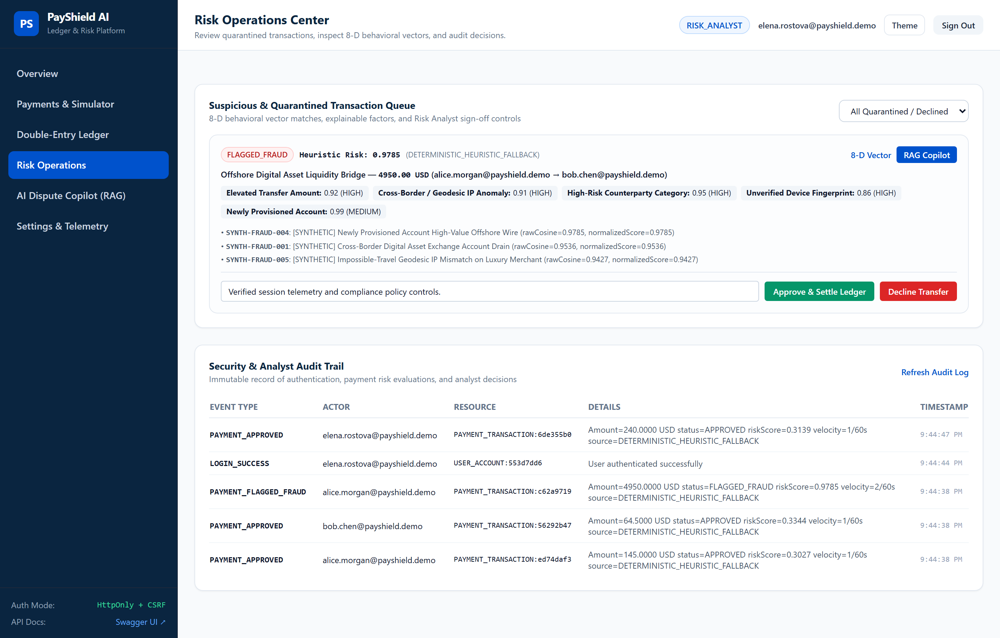
  <br/>
  <sub><strong>Risk Operations Center:</strong> Quarantined <code>FLAGGED_FRAUD</code> &amp; <code>REVIEW_REQUIRED</code> queue displaying explainable risk factors, top-K <code>SYNTH-FRAUD-*</code> similarity matches, analyst <em>Approve &amp; Settle</em> / <em>Decline</em> controls, and the live <code>SecurityAuditLog</code> trail.</sub>
</p>

<p align="center">
  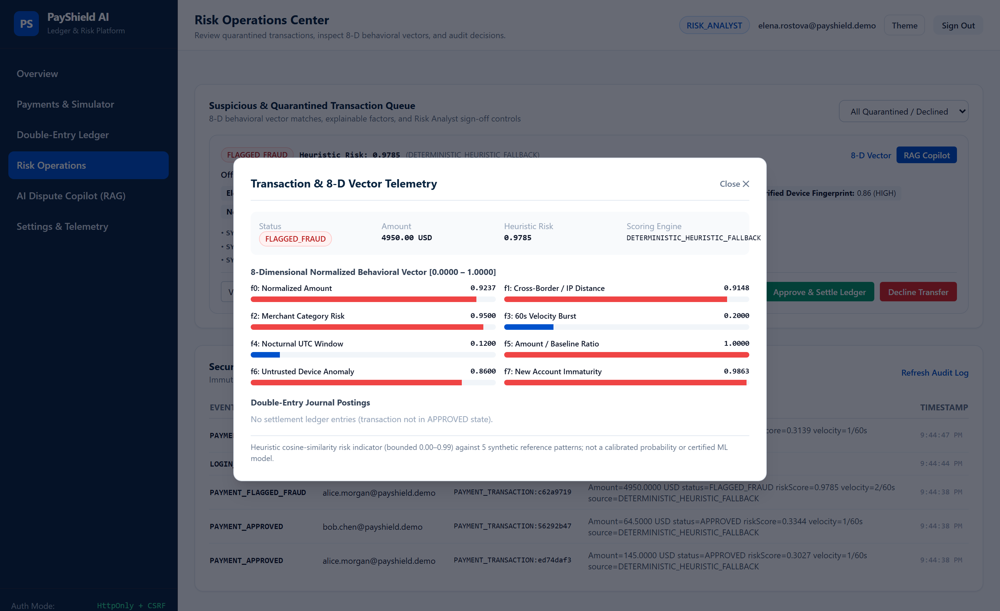
  <br/>
  <sub><strong>8-D Behavioral Vector Inspector:</strong> Per-transaction breakdown of all eight normalized risk dimensions (<code>f0</code>–<code>f7</code> in <code>[0.0000, 1.0000]</code>) and magnitude-attenuated similarity score.</sub>
</p>

Every transaction is mapped into a deterministic **8-dimensional normalized behavioral vector** $\mathbf{x} \in [0.0, 1.0]^8$ and queried against the versioned OpenSearch 2.12 HNSW index `fraud-behavior-vectors` (`cosinesimil`):

| Dim | Feature Key | Normalization Formula | Domain | Risk Signal Captured |
| :---: | :--- | :--- | :---: | :--- |
| `f0` | `f0_normalizedAmount` | `min(1.0, log10(1 + amount) / log10(10001))` | `[0, 1]` | Non-linear monetary magnitude (saturates at `10,000+`) |
| `f1` | `f1_crossBorderIpAnomaly` | `(src != dst ? 0.45 : 0) + min(0.55, ipKm / 10000 * 0.55)` | `[0, 1]` | Cross-border corridor shift + geodesic IP distance |
| `f2` | `f2_merchantRiskCategory` | Tiered MCC encoding (`0.10` SaaS/Grocery $\rightarrow$ `0.95` Crypto) | `[0, 1]` | Counterparty chargeback & money-mule typology risk |
| `f3` | `f3_velocityBurstScore` | `clamp((velocityCount - 1) / 5.0, 0, 1)` | `[0, 1]` | Rolling 60-second automated scripting / card-testing burst |
| `f4` | `f4_nocturnalTimeOfDayRisk` | `0.85` (`00:00–04:59 UTC`), `0.48` (transition), `0.12` (day) | `[0, 1]` | Off-hours nocturnal account-draining window |
| `f5` | `f5_amountToBaselineRatio` | `clamp((amount / 250.0) / 12.0, 0, 1)` | `[0, 1]` | Deviation from baseline retail transfer size |
| `f6` | `f6_untrustedDeviceAnomaly` | `clamp(1.0 - deviceTrustScore, 0, 1)` | `[0, 1]` | Unrecognized browser/device fingerprint or TOR/VPN session |
| `f7` | `f7_newAccountImmaturity` | `clamp(1.0 - min(1.0, accountAgeDays / 365.0), 0, 1)` | `[0, 1]` | Newly provisioned mule or synthetic identity risk |

#### Magnitude-Attenuated Score Normalization (`[0.00, 0.99]`)
Pure directional cosine similarity between a quiet domestic payment (`[0.12, 0.0, 0.10, ...]`) and an extreme fraud vector (`[0.92, 0.88, 0.95, ...]`) can over-score small vectors that happen to point in a similar octant. `FraudVectorEngine` applies a tested L2 magnitude-attenuated normalization bounded strictly in `[0.00, 0.99]`:

$$\text{Score}(\mathbf{q}, \mathbf{r}) = \min\left(0.99,\; \max(0, \cos\theta) \cdot \left(0.35 + 0.65 \cdot \min\left(1.0, \frac{\lVert\mathbf{q}\rVert_2}{\lVert\mathbf{r}\rVert_2}\right)\right)\right)$$

<details>
<summary><strong>📂 View Seeded Synthetic Fraud Patterns (5 Reference Vectors) &amp; Local Policy Corpus (v2.4.0)</strong></summary>

<br/>

**Seeded Synthetic OpenSearch Patterns (`fraud-behavior-vectors`):**
1. **`SYNTH-FRAUD-001`** — *Cross-Border Digital Asset Exchange Account Drain* (`POL-EFT-101, POL-MCC-409, POL-GEO-302`)
2. **`SYNTH-FRAUD-002`** — *Automated High-Velocity Card/Wallet Testing Burst* (`POL-VEL-204`)
3. **`SYNTH-FRAUD-003`** — *Nocturnal Account Takeover (ATO) from Unrecognized Device* (`POL-ATO-501, POL-GEO-302`)
4. **`SYNTH-FRAUD-004`** — *Newly Provisioned Account High-Value Offshore Wire* (`POL-EFT-101, POL-MCC-409`)
5. **`SYNTH-FRAUD-005`** — *Impossible-Travel Geodesic IP Mismatch on Luxury Merchant* (`POL-GEO-302, POL-MCC-409`)

**Versioned Compliance Policy Corpus (`src/main/resources/policies/compliance-policies-v2.4.json`):**
- **`POL-EFT-101`** (Sec 4.1): High-Value & Cross-Border Transfer Verification
- **`POL-VEL-204`** (Sec 6.2): Rolling 60-Second Transaction Velocity Enforcement
- **`POL-GEO-302`** (Sec 7.4): Geolocation Distance & Cross-Border Corridor Anomaly Policy
- **`POL-MCC-409`** (Sec 8.1): Digital Asset Exchanges, Offshore Gaming & Wire Counterparties
- **`POL-ATO-501`** (Sec 9.3): Untrusted Device & Nocturnal Window Draining Mitigation
- **`POL-LED-601`** (Sec 11.1): Zero-Sum Double-Entry Accounting & Non-Settlement of Quarantined Transfers

</details>

---

### 5. AI Dispute Copilot (RAG) & Context-Aware SHA-256 Caching

<p align="center">
  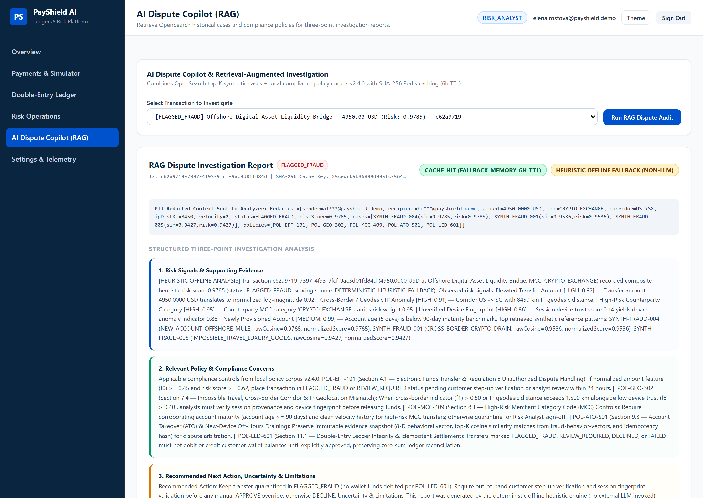
  <br/>
  <sub><strong>AI Dispute Copilot (RAG):</strong> Displays SHA-256 <code>CACHE_HIT</code>/<code>CACHE_MISS</code> status, honest <code>HEURISTIC OFFLINE FALLBACK</code> or live LLM generation badge, PII-redacted prompt context (<code>al***@payshield.demo</code>), and structured 3-point compliance analysis.</sub>
</p>

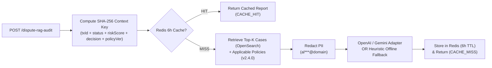

- **Zero-Secret Startup:** Defaults to `AI_PROVIDER=OFFLINE`, generating deterministic, citation-backed three-point investigation reports clearly badged as `HEURISTIC_OFFLINE_FALLBACK` (`llmGenerated: false`).
- **Plug-and-Play LLM Adapters:** Set `AI_PROVIDER=OPENAI_COMPATIBLE` or `AI_PROVIDER=GEMINI` with `AI_API_KEY` to switch live to GPT-4o-mini / Gemini while automatically falling back to the deterministic engine on timeouts or 5xx errors.
- **Context-Aware Cache Invalidation:** Approving or declining a quarantined transaction invalidates its Redis cache pointer and mutates the SHA-256 context signature so stale dispute reports are never served.

---

### 6. Session Security Controls & Live Infrastructure Telemetry

<p align="center">
  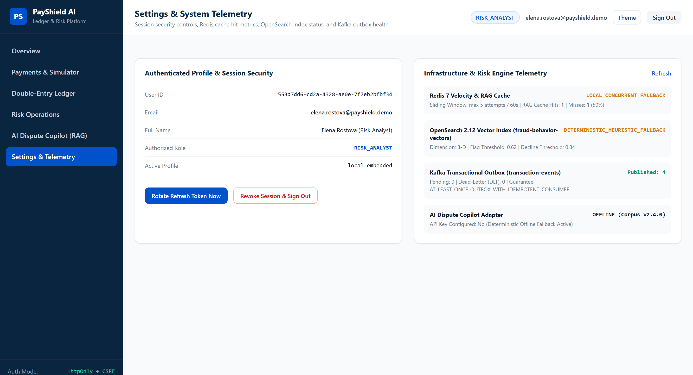
  <br/>
  <sub><strong>Settings &amp; System Telemetry:</strong> Inspect active principal metadata, trigger live refresh-token rotation or family revocation, and monitor Redis RAG cache hit rates, OpenSearch 8-D vector index mode, and Kafka transactional outbox delivery counters.</sub>
</p>

- **Transactional Outbox Observability:** Tracks `PENDING`, `PUBLISHED`, and `DEAD_LETTER` event counts for the `transaction-events` topic alongside consumer idempotency guarantees (`AT_LEAST_ONCE_OUTBOX_WITH_IDEMPOTENT_CONSUMER`).
- **Live Degraded-Mode Transparency:** Clearly surfaces whether Redis 7, OpenSearch 2.12, and external LLM adapters are operating against live cluster containers or deterministic degraded-mode fallbacks—never masking outages behind fake green indicators.

---

## 🚀 Quick Start (60 Seconds)

### Prerequisites
- **Java 21+** (Eclipse Temurin / OpenJDK 21)
- **Maven 3.9+** — *Included automatically via `./mvnw` and `.\mvnw.cmd`!*
- **Docker & Docker Compose** *(Optional — only required for Option A; Option B runs standalone with zero external daemons)*

### Option A: Full Distributed Stack via Docker Compose (Recommended)
Starts **PostgreSQL 16**, **Redis 7**, **Apache Kafka 3.7 (KRaft)**, **OpenSearch 2.12**, and **PayShield AI** with healthcheck dependency ordering:

```bash
# 1. Create local environment file from safe template
cp .env.example .env

# 2. Build and launch all 5 containers
docker compose up --build -d

# 3. Verify container health & readiness probe
docker compose ps
curl -s http://localhost:8080/actuator/health
```

### Option B: Instant Zero-Docker Standalone Mode (`local-embedded`)
Don't have Docker Desktop running? Run the full application immediately with an embedded PostgreSQL-compatible database and deterministic Redis, OpenSearch, and Outbox loopback fallbacks:

**Linux / macOS:**
```bash
./mvnw clean package -DskipTests
java -jar target/payshield-ai-1.0.0.jar --spring.profiles.active=local-embedded
```

**Windows (PowerShell):**
```powershell
.\mvnw.cmd clean package -DskipTests
java -jar target\payshield-ai-1.0.0.jar --spring.profiles.active=local-embedded
```

### 🌐 Local Endpoints & Sandbox Personas

| Interface | URL | Description |
| :--- | :--- | :--- |
| **Fintech Web Console** | `http://localhost:8080/` | Full responsive SPA dashboard |
| **Swagger UI (OpenAPI 3)** | `http://localhost:8080/swagger-ui.html` | Interactive REST API explorer |
| **OpenAPI JSON Spec** | `http://localhost:8080/v3/api-docs` | Machine-readable OpenAPI 3.0 contract |
| **Actuator Health** | `http://localhost:8080/actuator/health` | Liveness & readiness probes |

> [!TIP]
> **Local Sandbox Quick-Fill Accounts** *(Seeded automatically only when `demo-seed-enabled=true` in `local` / `local-embedded` / `test` profiles)*:
> - **Customer (Sender):** `alice.morgan@payshield.demo` / `PayShieldDemo1` (`$8,500.00 USD` & `€2,500.00 EUR`)
> - **Customer (Counterparty):** `bob.chen@payshield.demo` / `PayShieldDemo1` (`$4,200.00 USD` & `€2,500.00 EUR`)
> - **Risk Analyst:** `elena.rostova@payshield.demo` / `PayShieldDemo1` (Can review flagged queue & run global reconciliation)
> - **Platform Admin:** `marcus.vance@payshield.demo` / `PayShieldDemo1` (Full administrative & audit privileges)

---

## 📡 REST API Contract (21 Endpoints)

<p align="center">
  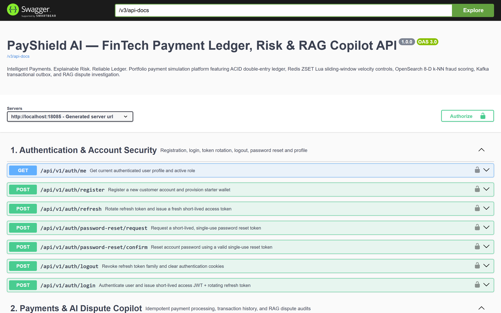
  <br/>
  <sub><strong>Interactive OpenAPI 3.0 / Swagger UI (<code>/swagger-ui.html</code>):</strong> Full schema-validated documentation for Authentication, Payments, Double-Entry Ledger, Risk Operations, and AI Dispute Copilot endpoints.</sub>
</p>

| Domain | Method & Endpoint | Auth / Role | Key Behavior |
| :--- | :--- | :--- | :--- |
| **Auth** | `POST /api/v1/auth/register` | Public | Creates `CUSTOMER` + starter wallet (`201 Created`) |
| **Auth** | `POST /api/v1/auth/login` | Public | Rate-limited BCrypt auth; sets `HttpOnly` + CSRF cookies |
| **Auth** | `POST /api/v1/auth/refresh` | Cookie / Body | Rotates refresh token; revokes family on token replay |
| **Auth** | `POST /api/v1/auth/logout` | Authenticated | Revokes refresh token family & clears cookies |
| **Auth** | `GET /api/v1/auth/me` | Authenticated | Returns current principal profile, role & environment |
| **Auth** | `POST /api/v1/auth/password-reset/request` | Public | Dispatches single-use 15m reset token via `LocalDevEmailAdapter` |
| **Auth** | `POST /api/v1/auth/password-reset/confirm` | Public | Consumes reset token, updates password & revokes sessions |
| **Payments** | `POST /api/v1/payments/process` | Authenticated | Requires `Idempotency-Key`; runs 8-D scoring & ACID settlement |
| **Payments** | `GET /api/v1/payments` | Authenticated | Paginated, sortable, searchable payment history |
| **Payments** | `GET /api/v1/payments/overview` | Authenticated | Aggregated wallet balances, status breakdown & alerts |
| **Payments** | `GET /api/v1/payments/{id}` | Owner / Analyst | Full payment telemetry, 8-D vector & ledger postings |
| **RAG AI** | `POST /api/v1/payments/{id}/dispute-rag-audit` | Owner / Analyst | Generates/serves SHA-256 cached 3-point RAG audit report |
| **Wallets** | `GET /api/v1/wallets/me` | Authenticated | Lists caller's currency-aware wallets & `NUMERIC(19,4)` balances |
| **Wallets** | `GET /api/v1/wallets/directory` | Authenticated | Safe counterparty directory for simulator transfers |
| **Ledger** | `GET /api/v1/ledger` | Authenticated | Paginated immutable `DEBIT` / `CREDIT` journal entries |
| **Ledger** | `GET /api/v1/ledger/reconciliation` | `RISK_ANALYST` / `ADMIN` | Verifies zero-sum accounting across all currencies |
| **Risk Ops** | `GET /api/v1/risk/transactions` | Authenticated | Quarantined `FLAGGED_FRAUD` & `REVIEW_REQUIRED` queue |
| **Risk Ops** | `POST /api/v1/risk/transactions/{id}/review` | `RISK_ANALYST` / `ADMIN` | `APPROVE` (settles ledger) or `DECLINE` with mandatory notes |
| **Risk Ops** | `POST /api/v1/risk/simulate-velocity` | Authenticated | Fires 7 rapid transfers to demonstrate `>5/60s` Lua ZSET limit |
| **Risk Ops** | `GET /api/v1/risk/metrics` | Authenticated | Live Redis hit-rate, OpenSearch mode & Kafka outbox counts |
| **Audit** | `GET /api/v1/audit` | `RISK_ANALYST` / `ADMIN` | Paginated `SecurityAuditLog` stream with correlation IDs |

<details>
<summary><strong>💻 Click to Expand Copy-Paste cURL Verification Playbook</strong></summary>

<br/>

```bash
# 1. Authenticate and capture short-lived Bearer JWT
TOKEN=$(curl -s -X POST http://localhost:8080/api/v1/auth/login \
  -H "Content-Type: application/json" \
  -d '{"email":"alice.morgan@payshield.demo","password":"PayShieldDemo1"}' \
  | jq -r '.accessToken')

# 2. Submit an idempotent domestic transfer (Returns 201 Created, idempotentReplay: false)
curl -s -X POST http://localhost:8080/api/v1/payments/process \
  -H "Authorization: Bearer $TOKEN" \
  -H "Idempotency-Key: idem-curl-demo-001" \
  -H "Content-Type: application/json" \
  -d '{
    "recipientIdentifier": "bob.chen@payshield.demo",
    "amount": 125.50,
    "currency": "USD",
    "merchantName": "Cloud SaaS Billing",
    "merchantCategory": "SAAS_SUBSCRIPTION",
    "sourceCountry": "US",
    "destinationCountry": "US",
    "ipDistanceKm": 18.0,
    "deviceTrustScore": 0.97,
    "accountAgeDays": 400
  }' | jq '{id, status, riskScore, idempotentReplay, processingLatencyMs}'

# 3. Replay the EXACT same Idempotency-Key (Returns 200 OK, idempotentReplay: true, zero duplicate debit!)
curl -s -X POST http://localhost:8080/api/v1/payments/process \
  -H "Authorization: Bearer $TOKEN" \
  -H "Idempotency-Key: idem-curl-demo-001" \
  -H "Content-Type: application/json" \
  -d '{
    "recipientIdentifier": "bob.chen@payshield.demo",
    "amount": 125.50,
    "currency": "USD",
    "merchantName": "Cloud SaaS Billing",
    "merchantCategory": "SAAS_SUBSCRIPTION",
    "sourceCountry": "US",
    "destinationCountry": "US",
    "ipDistanceKm": 18.0,
    "deviceTrustScore": 0.97,
    "accountAgeDays": 400
  }' | jq '{id, status, idempotentReplay}'

# 4. Tamper with the amount on the same Idempotency-Key (Returns 409 Conflict — IDEMPOTENCY_PAYLOAD_MISMATCH)
curl -i -X POST http://localhost:8080/api/v1/payments/process \
  -H "Authorization: Bearer $TOKEN" \
  -H "Idempotency-Key: idem-curl-demo-001" \
  -H "Content-Type: application/json" \
  -d '{
    "recipientIdentifier": "bob.chen@payshield.demo",
    "amount": 9999.00,
    "currency": "USD",
    "merchantName": "Cloud SaaS Billing",
    "merchantCategory": "SAAS_SUBSCRIPTION",
    "sourceCountry": "US",
    "destinationCountry": "US",
    "ipDistanceKm": 18.0
  }'

# 5. Run AI Dispute Copilot RAG Audit twice to observe CACHE_MISS -> CACHE_HIT
TX_ID=$(curl -s "http://localhost:8080/api/v1/payments?page=0&size=1" \
  -H "Authorization: Bearer $TOKEN" | jq -r '.content[0].id')

curl -s -X POST "http://localhost:8080/api/v1/payments/$TX_ID/dispute-rag-audit" \
  -H "Authorization: Bearer $TOKEN" | jq '{cacheStatus, generationMode, citedCaseIds, citedPolicyIds}'
```

</details>

---

## 🧪 Verified Test Matrix (`18/18` Passing)

Execute the complete deterministic unit, concurrency, security, and integration test suite:

```bash
./mvnw clean verify
```

| Test Suite | Tests | Invariants & Scenarios Verified |
| :--- | :---: | :--- |
| **`AuthAndSecurityIntegrationTest`** | `5` | Customer registration & EUR starter wallet; weak password `400` field errors; duplicate email `409`; expired JWT rejection (`401`); refresh-token rotation & **token-family revocation on replay**; double-submit CSRF cookie enforcement (`403` vs `200`); single-use password reset; `CUSTOMER` vs `RISK_ANALYST` vs `ADMIN` RBAC boundaries |
| **`PaymentLedgerAndConcurrencyIntegrationTest`** | `3` | `Idempotency-Key` replay deduplication (`200 OK`) & tampered payload rejection (`409`); **8-thread concurrent overspend race test** (`8 x $600` against `$1,500` wallet $\rightarrow$ exactly 2 succeed, 6 fail `422`, final balance `$300.0000`, zero-sum reconciliation `true`); high-risk `FLAGGED_FRAUD` quarantine $\rightarrow$ RAG `CACHE_MISS`/`CACHE_HIT` $\rightarrow$ Analyst approval settlement & cache invalidation |
| **`FraudVectorEngineTest`** | `5` | 8-D feature normalization in `[0.0, 1.0]`; cosine similarity & `[0.00, 0.99]` score normalization bounds; low-risk domestic approval; high-risk offshore crypto anomaly detection; OpenSearch unavailable & empty-index deterministic fallbacks |
| **`RedisRiskEngineTest`** | `3` | Redis Lua `ZSET` sliding-window boundary (`1..5` allowed, `6th` flagged); 10-thread concurrent fallback under Redis outage; SHA-256 RAG cache hit/miss counters & explicit invalidation |
| **`KafkaOutboxAndConsumerTest`** | `2` | Idempotent consumer duplicate-event protection via `processed_kafka_events`; transactional outbox 3-attempt exponential backoff, transition to `DEAD_LETTER`, and administrative `recoverDeadLetterEvents()` replay |

---

## ⚙️ Configuration, Project Structure & Production Hardening

<details>
<summary><strong>🗂️ View Complete Repository Directory Tree</strong></summary>

<br/>

```text
payshield-ai/
├── .env.example
├── .gitattributes
├── .gitignore
├── Dockerfile
├── docker-compose.yml
├── mvnw
├── mvnw.cmd
├── pom.xml
├── README.md
├── docs/
│   ├── assets/
│   │   └── payshield-banner.svg
│   └── screenshots/
│       ├── 01-auth-portal.png
│       ├── 02-executive-overview.png
│       ├── 03-payment-simulator.png
│       ├── 04-double-entry-ledger.png
│       ├── 05-risk-operations.png
│       ├── 06-8d-vector-inspector.png
│       ├── 07-rag-dispute-copilot.png
│       ├── 08-settings-telemetry.png
│       └── 09-swagger-openapi.png
├── .github/
│   └── workflows/
│       └── ci.yml
└── src/
    ├── main/
    │   ├── java/com/payshield/
    │   │   ├── PayShieldAiApplication.java
    │   │   ├── config/          # AppProperties, SecurityConfig, KafkaConfig, OpenApiConfig, CorrelationIdFilter, BootstrapInitializer
    │   │   ├── controller/      # AuthController, PaymentController, WalletLedgerController, RiskController
    │   │   ├── domain/          # UserAccount, Wallet, PaymentTransaction, LedgerEntry, OutboxEvent, ProcessedKafkaEvent, RefreshToken...
    │   │   ├── dto/             # AuthDtos, PaymentLedgerDtos, TransactionEventPayload
    │   │   ├── exception/       # ApiException, GlobalExceptionHandler
    │   │   ├── repository/      # 9 Spring Data JPA Repositories (with PESSIMISTIC_WRITE wallet locking)
    │   │   ├── security/        # AuthenticatedUser, JwtAuthenticationFilter, JwtTokenService
    │   │   ├── service/         # AuthService, PaymentLedgerService, RedisRiskEngine, FraudVectorEngine, OutboxPublisherService, RagDisputeCopilotService...
    │   │   └── util/            # HashUtils (SHA-256)
    │   └── resources/
    │       ├── application.yml
    │       ├── application-local.yml
    │       ├── application-local-embedded.yml
    │       ├── db/migration/V1__init_payshield_schema.sql
    │       ├── policies/compliance-policies-v2.4.json
    │       └── static/index.html
    └── test/
        ├── java/com/payshield/  # 5 JUnit 5 Unit, Concurrency & Integration Test Suites (18 tests)
        └── resources/application-test.yml
```

</details>

<details>
<summary><strong>🔧 View Environment Variables Reference (<code>.env.example</code>)</strong></summary>

<br/>

| Variable | Local Default | Purpose |
| :--- | :--- | :--- |
| `SPRING_PROFILES_ACTIVE` | `local` | `production`, `local`, `local-embedded`, or `test` |
| `POSTGRES_HOST` / `POSTGRES_PORT` / `POSTGRES_DB` | `localhost` / `5432` / `payshield` | PostgreSQL 16 connection coordinates |
| `POSTGRES_USER` / `POSTGRES_PASSWORD` | `payshield_user` / *(placeholder)* | Database credentials |
| `REDIS_HOST` / `REDIS_PORT` | `localhost` / `6379` | Redis 7 velocity & RAG cache store |
| `KAFKA_BOOTSTRAP_SERVERS` | `localhost:9092` | Apache Kafka 3.7 KRaft brokers |
| `OPENSEARCH_HOST` / `OPENSEARCH_PORT` | `localhost` / `9200` | OpenSearch 2.12 vector engine |
| `JWT_SECRET` | *(32+ char secret)* | HMAC-SHA256 signing key ($\ge 256$ bits required) |
| `APP_COOKIE_SECURE` | `false` (`true` in prod) | Enforces HTTPS-only transmission of auth cookies |
| `BOOTSTRAP_ADMIN_EMAIL` / `BOOTSTRAP_ADMIN_PASSWORD` | *(empty)* | Explicit, non-hardcoded first-admin provisioning |
| `RISK_VELOCITY_MAX_ATTEMPTS` / `RISK_VELOCITY_WINDOW_SECONDS` | `5` / `60` | Rolling velocity window threshold |
| `RISK_FLAG_THRESHOLD` / `RISK_DECLINE_THRESHOLD` | `0.62` / `0.84` | 8-D vector review & fraud quarantine cutoffs |
| `AI_PROVIDER` / `AI_API_KEY` / `AI_MODEL` | `OFFLINE` / *(empty)* / `gpt-4o-mini` | `OFFLINE`, `OPENAI_COMPATIBLE`, or `GEMINI` |

</details>

### Security & Architectural Honesty Notes
1. **No Default Production Admin Credentials:** Production (`DEMO_SEED_ENABLED=false`) starts with zero demo users. Provision the initial administrator via `BOOTSTRAP_ADMIN_EMAIL` and `BOOTSTRAP_ADMIN_PASSWORD` on first boot, then clear those environment variables.
2. **Non-Root Container Runtime:** Multi-stage `Dockerfile` compiles on Eclipse Temurin 21 JDK and executes on Temurin 21 JRE as unprivileged UID/GID `10001` (`payshield:payshield`), while `docker-compose.yml` binds database/broker ports strictly to `127.0.0.1`.
3. **Honest Delivery & Scoring Guarantees:**
   - Event publishing provides **at-least-once** delivery from the transactional outbox paired with **idempotent consumer deduplication** in `processed_kafka_events` (not distributed cross-broker XA transactions).
   - Vector similarity scores (`0.00–0.99`) are **heuristic behavioral indicators** computed over 5 synthetic reference vectors, not calibrated fraud probabilities.

---

## 🎯 Technical Interview & Resume Highlights

- **ACID Double-Entry Payment Ledger:** Architected a currency-aware wallet and immutable double-entry journal in **Java 21 / Spring Boot 3 / PostgreSQL 16** (`NUMERIC(19,4)`), eliminating race-condition overspending and deadlocks via UUID-ordered `SELECT ... FOR UPDATE` pessimistic locking, `@Version` optimistic concurrency, and SHA-256 payload-validated `Idempotency-Key` deduplication.
- **Real-Time Hybrid Fraud Engine:** Combined **Redis 7** atomic Lua sorted-set (`ZSET`) sliding-window velocity limiting (`>5 attempts/60s`) with an **8-dimensional behavioral vector engine** querying **OpenSearch 2.12 k-NN** (`cosinesimil`) and deterministic degraded-mode fallbacks.
- **Reliable Event-Driven Architecture:** Implemented the **Transactional Outbox** pattern over **Apache Kafka 3.7 (KRaft)** with 3-attempt exponential backoff retries, `.DLT` dead-letter routing, correlation ID propagation, and idempotent consumer deduplication.
- **Explainable AI Dispute Copilot (RAG):** Built a PII-redacting RAG investigation service uniting OpenSearch top-K case evidence and a versioned compliance policy corpus (`v2.4.0`), backed by context-aware SHA-256 Redis caching (`6h` TTL) and OpenAI / Gemini / deterministic offline adapters.

---

<div align="center">
  <sub>Built with Java 21, Spring Boot 3, PostgreSQL 16, Redis 7, Kafka 3.7, and OpenSearch 2.12 • <strong>PayShield AI</strong></sub>
</div>
