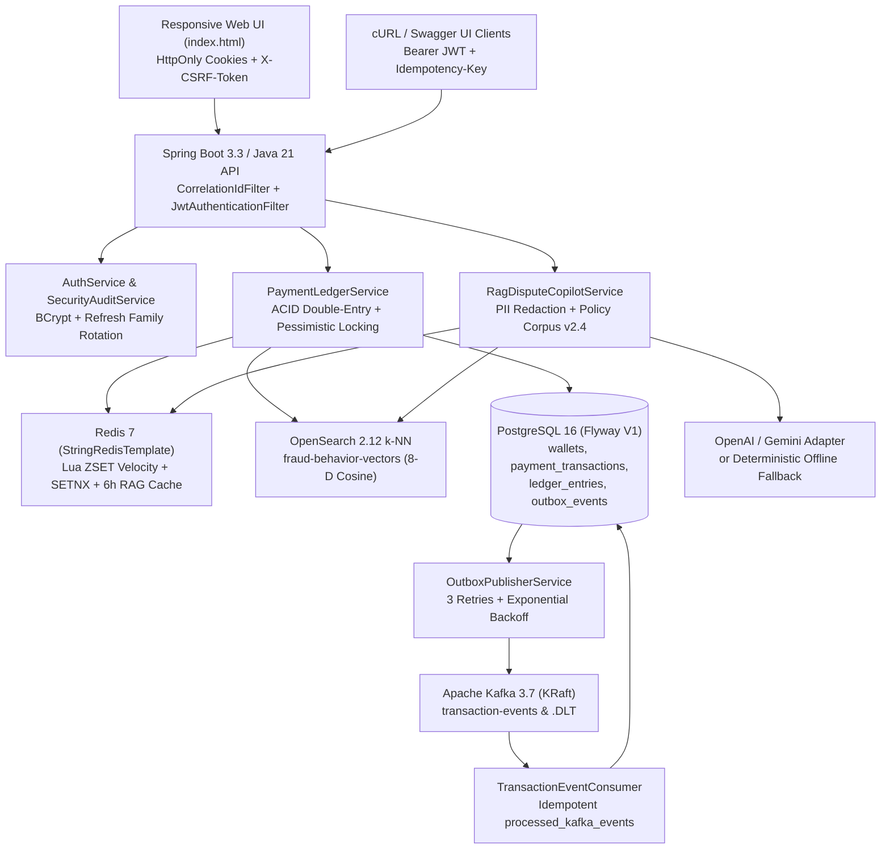
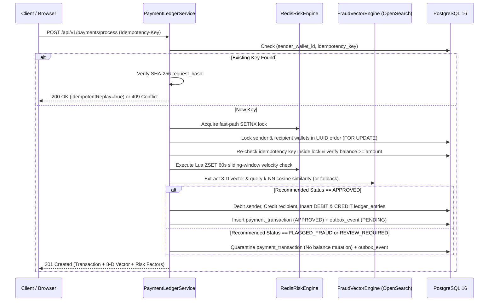

# PayShield AI

**Intelligent Payments. Explainable Risk. Reliable Ledger.**

> **Portfolio Disclaimer:** PayShield AI is a full-stack FinTech payment simulation, double-entry ledger, behavioral fraud scoring, and AI dispute investigation platform engineered for software engineering portfolios and technical interviews. It operates strictly on simulated wallet balances (`BigDecimal` / `NUMERIC(19,4)`) and is **not** a licensed money transmitter, real-money payment processor, or statistically calibrated/certified production fraud model.

---

## 1. Executive Summary & Core Capabilities

PayShield AI demonstrates production-grade FinTech engineering patterns across six core pillars:

1. **Account Security & RBAC Authentication (`CUSTOMER`, `RISK_ANALYST`, `ADMIN`)**
   - Password hashing via `BCryptPasswordEncoder(12)`.
   - Short-lived HMAC-SHA256 JWT access tokens (`15m` default) paired with opaque cryptographic refresh tokens (`7d` default) stored as SHA-256 digests.
   - **Refresh-Token Rotation & Reuse Detection:** Presenting an already-rotated refresh token immediately revokes the entire token family (`family_id`) and records a `REFRESH_TOKEN_REUSE_DETECTED` audit event.
   - Dual transport support: `HttpOnly`, `SameSite=Lax` cookies (`ps_access_token`, `ps_refresh_token`) with mandatory double-submit CSRF verification (`X-CSRF-Token` header matching `ps_csrf_token` cookie) on state-changing cookie-authenticated requests, plus `Authorization: Bearer <token>` for API/CLI clients.
   - Per-IP/email sliding-window login rate limiting, temporary account lockout after 5 failed attempts, generic authentication error responses, and single-use 15-minute password reset tokens via `LocalDevEmailAdapter`.

2. **ACID Double-Entry Payment Ledger Engine**
   - Currency-aware wallets (`USD`, `EUR`, `GBP`) stored using Java `BigDecimal` (scale 4) and PostgreSQL `NUMERIC(19, 4)` — never floating-point types.
   - Deterministic UUID-ordered pessimistic write locking (`SELECT ... FOR UPDATE`) combined with `@Version` optimistic concurrency protection to prevent deadlocks and overspending under concurrent load.
   - Durable `Idempotency-Key` deduplication backed by `UNIQUE (sender_wallet_id, idempotency_key)` and canonical SHA-256 request payload hashing (`409 Conflict` on payload mismatch; `200 OK` with `idempotentReplay: true` on identical retries), coordinated with fast-path Redis `SETNX`.
   - **Explicit Fraud-to-Ledger Execution Contract:** Only `APPROVED` transactions debit/credit wallet balances and insert immutable `DEBIT` and `CREDIT` `LedgerEntry` rows. `FLAGGED_FRAUD` and `REVIEW_REQUIRED` transactions are quarantined prior to settlement until reviewed by a `RISK_ANALYST` or `ADMIN`.
   - Zero-sum ledger reconciliation (`GET /api/v1/ledger/reconciliation`) verifying `SUM(DEBIT) == SUM(CREDIT)` per currency and 1:1 double-entry completeness across all settled transactions.

3. **Redis 7 Risk & Caching Engine**
   - Sliding-window velocity limiter using Redis sorted sets (`ZSET`) and an atomic Lua script (`ZREMRANGEBYSCORE`, `ZADD`, `ZCARD`, `EXPIRE`) enforcing a default threshold of `> 5` attempts per user within a rolling `60-second` window.
   - Deterministic, concurrency-safe local fallback when Redis is unreachable, surfaced transparently in `/api/v1/risk/metrics`.
   - Context-aware SHA-256 caching (`payshield:rag:v1:<sha256>`) with a 6-hour TTL for RAG dispute reports and automatic cache invalidation when an analyst updates a transaction's status.

4. **8-Dimensional Behavioral Vector & OpenSearch 2.12 k-NN Fraud Engine**
   - Versioned OpenSearch k-NN index (`fraud-behavior-vectors`, schema `v1.0`, dimension `8`, `cosinesimil` HNSW).
   - Explicitly documented 8-D normalized feature vector $\mathbf{x} \in [0.0, 1.0]^8$:
     - `f0_normalizedAmount`: $\min(1.0, \log_{10}(1 + \text{amount}) / \log_{10}(10001))$
     - `f1_crossBorderIpAnomaly`: Cross-border indicator ($0.45$) + geodesic IP distance normalized over $10,000\text{ km}$ ($0.55$)
     - `f2_merchantRiskCategory`: MCC risk encoding (`GROCERY`/`SAAS_SUBSCRIPTION` $0.10 \rightarrow$ `CRYPTO_EXCHANGE` $0.95$)
     - `f3_velocityBurstScore`: Rolling 60s attempt velocity normalized over threshold
     - `f4_nocturnalTimeOfDayRisk`: UTC nocturnal window indicator (`00:00–04:59 UTC` $\rightarrow 0.85$)
     - `f5_amountToBaselineRatio`: Ratio against baseline transfer size
     - `f6_untrustedDeviceAnomaly`: $1.0 - \text{deviceTrustScore}$
     - `f7_newAccountImmaturity`: $1.0 - \min(1.0, \text{accountAgeDays} / 365)$
   - Defined score-normalization function weighting directional cosine similarity by L2 activation magnitude ratio, bounded strictly in `[0.00, 0.99]`.
   - Seeded with 5 clearly labeled synthetic historical fraud patterns (`SYNTH-FRAUD-001` through `SYNTH-FRAUD-005`) and automatic deterministic fallback scoring when OpenSearch is offline.

5. **Kafka 3.7 (KRaft) & Transactional Outbox Pattern**
   - `OutboxEvent` records are persisted inside the same ACID database transaction as payment and ledger state transitions.
   - `OutboxPublisherService` relays pending events to Kafka topic `transaction-events` with 3 attempts, exponential backoff, and dead-letter transitions (`OutboxStatus.DEAD_LETTER` / `transaction-events.DLT`).
   - `TransactionEventConsumer` enforces idempotent consumption via the `processed_kafka_events` table (`event_id` primary key deduplication).
   - **Delivery Guarantee:** At-least-once outbox publication paired with idempotent consumer deduplication (not claimed as distributed end-to-end exactly-once).

6. **AI Dispute Copilot & Retrieval-Augmented Generation (RAG)**
   - Retrieves top-K similar historical cases (`SYNTH-FRAUD-*`) and applicable sections from the local versioned compliance corpus (`src/main/resources/policies/compliance-policies-v2.4.json`: `POL-EFT-101`, `POL-VEL-204`, `POL-GEO-302`, `POL-MCC-409`, `POL-ATO-501`, `POL-LED-601`).
   - Redacts PII (email addresses, raw identifiers) before any external API call.
   - Supports `OPENAI_COMPATIBLE` (`/chat/completions`), `GEMINI` (`:generateContent`), and a deterministic `OFFLINE` fallback (`HEURISTIC_OFFLINE_FALLBACK`) that starts and runs with zero external API keys.

---

## 2. Architecture & Request-Flow Diagrams

### System Architecture



### Idempotent Payment & Fraud Evaluation Flow



---

## 3. Repository Directory Structure

```text
payshield-ai/
├── .env.example
├── .gitignore
├── Dockerfile
├── docker-compose.yml
├── mvnw
├── mvnw.cmd
├── pom.xml
├── README.md
├── .github/
│   └── workflows/
│       └── ci.yml
├── .mvn/
│   └── wrapper/
│       └── maven-wrapper.properties
└── src/
    ├── main/
    │   ├── java/com/payshield/
    │   │   ├── PayShieldAiApplication.java
    │   │   ├── config/
    │   │   │   ├── AppProperties.java
    │   │   │   ├── BootstrapInitializer.java
    │   │   │   ├── CorrelationIdFilter.java
    │   │   │   ├── KafkaConfig.java
    │   │   │   ├── OpenApiConfig.java
    │   │   │   └── SecurityConfig.java
    │   │   ├── controller/
    │   │   │   ├── AuthController.java
    │   │   │   ├── PaymentController.java
    │   │   │   ├── RiskController.java
    │   │   │   └── WalletLedgerController.java
    │   │   ├── domain/
    │   │   │   ├── LedgerEntry.java
    │   │   │   ├── LedgerEntryType.java
    │   │   │   ├── OutboxEvent.java
    │   │   │   ├── OutboxStatus.java
    │   │   │   ├── PasswordResetToken.java
    │   │   │   ├── PaymentStatus.java
    │   │   │   ├── PaymentTransaction.java
    │   │   │   ├── ProcessedKafkaEvent.java
    │   │   │   ├── RefreshToken.java
    │   │   │   ├── Role.java
    │   │   │   ├── SecurityAuditLog.java
    │   │   │   ├── SupportedCurrency.java
    │   │   │   ├── UserAccount.java
    │   │   │   └── Wallet.java
    │   │   ├── dto/
    │   │   │   ├── AuthDtos.java
    │   │   │   ├── PaymentLedgerDtos.java
    │   │   │   └── TransactionEventPayload.java
    │   │   ├── exception/
    │   │   │   ├── ApiException.java
    │   │   │   └── GlobalExceptionHandler.java
    │   │   ├── repository/
    │   │   │   ├── LedgerEntryRepository.java
    │   │   │   ├── OutboxEventRepository.java
    │   │   │   ├── PasswordResetTokenRepository.java
    │   │   │   ├── PaymentTransactionRepository.java
    │   │   │   ├── ProcessedKafkaEventRepository.java
    │   │   │   ├── RefreshTokenRepository.java
    │   │   │   ├── SecurityAuditLogRepository.java
    │   │   │   ├── UserAccountRepository.java
    │   │   │   └── WalletRepository.java
    │   │   ├── security/
    │   │   │   ├── AuthenticatedUser.java
    │   │   │   ├── JwtAuthenticationFilter.java
    │   │   │   └── JwtTokenService.java
    │   │   ├── service/
    │   │   │   ├── AuthService.java
    │   │   │   ├── FraudVectorEngine.java
    │   │   │   ├── LocalDevEmailAdapter.java
    │   │   │   ├── OutboxPublisherService.java
    │   │   │   ├── PaymentLedgerService.java
    │   │   │   ├── RagDisputeCopilotService.java
    │   │   │   ├── RedisRiskEngine.java
    │   │   │   ├── SecurityAuditService.java
    │   │   │   └── TransactionEventConsumer.java
    │   │   └── util/
    │   │       └── HashUtils.java
    │   └── resources/
    │       ├── application.yml
    │       ├── application-local.yml
    │       ├── application-local-embedded.yml
    │       ├── db/migration/
    │       │   └── V1__init_payshield_schema.sql
    │       ├── policies/
    │       │   └── compliance-policies-v2.4.json
    │       └── static/
    │           └── index.html
    └── test/
        ├── java/com/payshield/
        │   ├── AuthAndSecurityIntegrationTest.java
        │   ├── FraudVectorEngineTest.java
        │   ├── KafkaOutboxAndConsumerTest.java
        │   ├── PaymentLedgerAndConcurrencyIntegrationTest.java
        │   └── RedisRiskEngineTest.java
        └── resources/
            └── application-test.yml
```

---

## 4. Prerequisites & Startup Instructions

### Prerequisites
- **Java 21+** (Eclipse Temurin / OpenJDK 21)
- **Maven 3.9+** (included via `./mvnw` and `.\mvnw.cmd` Maven Wrapper)
- **Docker & Docker Compose** (optional for full-stack container mode; the application also includes a zero-dependency `local-embedded` profile for environments without Docker running)

### Option A: Full Docker Compose Stack (PostgreSQL 16, Redis 7, Kafka 3.7 KRaft, OpenSearch 2.12, App)

```bash
# 1. Copy environment template
cp .env.example .env

# 2. Build and start all services with healthcheck ordering
docker compose up --build -d

# 3. Inspect service health
docker compose ps
curl -s http://localhost:8080/actuator/health

# 4. Stop stack (preserving volumes)
docker compose down

# 5. Full reset (destroy persistent data volumes)
docker compose down -v
```

### Option B: Local Standalone Startup (Maven Wrapper)

If PostgreSQL/Redis/Kafka/OpenSearch are running on `localhost`:
```bash
./mvnw spring-boot:run -Dspring-boot.run.profiles=local
```

If running on a machine without Docker daemon started (uses embedded PostgreSQL-compatible database + deterministic Redis/OpenSearch/Kafka fallbacks):
```bash
./mvnw spring-boot:run -Dspring-boot.run.profiles=local-embedded
```

Access the application:
- **Web Dashboard:** `http://localhost:8080/`
- **Swagger UI / OpenAPI 3.0:** `http://localhost:8080/swagger-ui.html`
- **OpenAPI JSON Spec:** `http://localhost:8080/v3/api-docs`
- **Actuator Health:** `http://localhost:8080/actuator/health`

---

## 5. Environment Variable Reference

| Variable | Default (Local) | Description |
|---|---|---|
| `SERVER_PORT` | `8080` | HTTP server port |
| `SPRING_PROFILES_ACTIVE` | `local` | Active Spring profile (`production`, `local`, `local-embedded`, `test`) |
| `POSTGRES_HOST` / `POSTGRES_PORT` | `localhost` / `5432` | PostgreSQL 16 host and port |
| `POSTGRES_DB` / `POSTGRES_USER` / `POSTGRES_PASSWORD` | `payshield` / `payshield_user` / `...` | PostgreSQL database credentials |
| `REDIS_HOST` / `REDIS_PORT` | `localhost` / `6379` | Redis 7 host and port |
| `KAFKA_BOOTSTRAP_SERVERS` | `localhost:9092` | Apache Kafka 3.7 KRaft bootstrap servers |
| `OPENSEARCH_HOST` / `OPENSEARCH_PORT` | `localhost` / `9200` | OpenSearch 2.12 endpoint |
| `JWT_SECRET` | *(32+ char secret)* | HMAC-SHA256 signing secret (minimum 256 bits) |
| `JWT_ACCESS_EXPIRATION_SECONDS` | `900` | Short-lived access token TTL (15 minutes) |
| `JWT_REFRESH_EXPIRATION_SECONDS` | `604800` | Rotating refresh token TTL (7 days) |
| `BOOTSTRAP_ADMIN_EMAIL` / `BOOTSTRAP_ADMIN_PASSWORD` | *(empty)* | Explicit first-admin bootstrap credentials |
| `RISK_VELOCITY_MAX_ATTEMPTS` / `RISK_VELOCITY_WINDOW_SECONDS` | `5` / `60` | Sliding-window velocity threshold |
| `RISK_FLAG_THRESHOLD` / `RISK_DECLINE_THRESHOLD` | `0.62` / `0.84` | 8-D vector risk review & quarantine thresholds |
| `AI_PROVIDER` | `OFFLINE` | `OFFLINE`, `OPENAI_COMPATIBLE`, or `GEMINI` |
| `AI_API_KEY` / `AI_BASE_URL` / `AI_MODEL` | *(empty)* | External LLM credentials (optional; never required to start) |

---

## 6. Authentication, RBAC Roles & First-Admin Bootstrap

### Roles
- **`CUSTOMER`**: Can view own wallets, initiate idempotent transfers, run velocity simulations on own account, view own ledger entries, and run RAG dispute audits on own transactions.
- **`RISK_ANALYST`**: All customer capabilities plus access to the global suspicious transaction queue (`GET /api/v1/risk/transactions`), analyst sign-off (`POST /api/v1/risk/transactions/{id}/review` to `APPROVE` or `DECLINE`), zero-sum ledger reconciliation (`GET /api/v1/ledger/reconciliation`), and security audit logs (`GET /api/v1/audit`).
- **`ADMIN`**: Full platform administrative access, reconciliation, risk review, and audit inspection.

### First-Admin Bootstrap (Production)
PayShield AI has **no default hardcoded admin password in production**. To provision the initial administrator in production, set `BOOTSTRAP_ADMIN_EMAIL` and `BOOTSTRAP_ADMIN_PASSWORD` on first startup; `BootstrapInitializer` creates the `ADMIN` account idempotently and records an `ADMIN_BOOTSTRAPPED` audit log entry, after which those variables can be removed.

### Local Sandbox Demo Personas (Active ONLY when `demo-seed-enabled=true`)
- **Customer:** `alice.morgan@payshield.demo` / `PayShieldDemo1`
- **Counterparty Customer:** `bob.chen@payshield.demo` / `PayShieldDemo1`
- **Risk Analyst:** `elena.rostova@payshield.demo` / `PayShieldDemo1`
- **Admin:** `marcus.vance@payshield.demo` / `PayShieldDemo1`

---

## 7. API cURL Verification Examples

### 1. Register a New Customer Account
```bash
curl -i -X POST http://localhost:8080/api/v1/auth/register \
  -H "Content-Type: application/json" \
  -d '{
    "email": "david.kim@example.com",
    "fullName": "David Kim",
    "password": "StrongPassword2026",
    "initialCurrency": "USD"
  }'
```

### 2. Login and Capture Access Token
```bash
TOKEN=$(curl -s -X POST http://localhost:8080/api/v1/auth/login \
  -H "Content-Type: application/json" \
  -d '{"email":"alice.morgan@payshield.demo","password":"PayShieldDemo1"}' \
  | jq -r '.accessToken')
```

### 3. Execute an Idempotent Payment Transfer
```bash
curl -i -X POST http://localhost:8080/api/v1/payments/process \
  -H "Authorization: Bearer $TOKEN" \
  -H "Idempotency-Key: idem-demo-transfer-001" \
  -H "Content-Type: application/json" \
  -d '{
    "recipientIdentifier": "bob.chen@payshield.demo",
    "amount": 125.50,
    "currency": "USD",
    "merchantName": "Acme Cloud Services",
    "merchantCategory": "SAAS_SUBSCRIPTION",
    "sourceCountry": "US",
    "destinationCountry": "US",
    "ipDistanceKm": 20.0,
    "deviceTrustScore": 0.96,
    "accountAgeDays": 365
  }'
```

### 4. Replay the Exact Same `Idempotency-Key` (Returns `200 OK` with `idempotentReplay: true`)
```bash
curl -i -X POST http://localhost:8080/api/v1/payments/process \
  -H "Authorization: Bearer $TOKEN" \
  -H "Idempotency-Key: idem-demo-transfer-001" \
  -H "Content-Type: application/json" \
  -d '{
    "recipientIdentifier": "bob.chen@payshield.demo",
    "amount": 125.50,
    "currency": "USD",
    "merchantName": "Acme Cloud Services",
    "merchantCategory": "SAAS_SUBSCRIPTION",
    "sourceCountry": "US",
    "destinationCountry": "US",
    "ipDistanceKm": 20.0,
    "deviceTrustScore": 0.96,
    "accountAgeDays": 365
  }'
```

### 5. Run AI Dispute Copilot RAG Audit on a Transaction
```bash
curl -s -X POST http://localhost:8080/api/v1/payments/<TRANSACTION_ID>/dispute-rag-audit \
  -H "Authorization: Bearer $TOKEN" | jq .
```

---

## 8. Testing & Verification

Run the complete unit and integration test suite:
```bash
./mvnw clean verify
```

### Verified Test Suite Coverage
- `FraudVectorEngineTest` (5 tests): 8-D vector normalization, `[0.00, 0.99]` score normalization bounds, low-risk approval, high-risk synthetic pattern detection, OpenSearch unavailable & empty-index fallback.
- `RedisRiskEngineTest` (3 tests): Redis Lua ZSET sliding-window velocity boundary (`1..5` allowed, `6th` flagged), concurrent fallback under Redis outage, SHA-256 RAG cache hit/miss & invalidation.
- `KafkaOutboxAndConsumerTest` (2 tests): Idempotent consumer duplicate event protection (`ProcessedKafkaEvent`), transactional outbox 3-attempt retry with exponential backoff, transition to `DEAD_LETTER`, and dead-letter recovery.
- `AuthAndSecurityIntegrationTest` (5 tests): Registration & starter wallet creation, password validation, expired JWT rejection, refresh-token rotation & reuse family revocation, double-submit CSRF cookie enforcement, single-use password reset, and RBAC authorization (`CUSTOMER` vs `RISK_ANALYST` vs `ADMIN`).
- `PaymentLedgerAndConcurrencyIntegrationTest` (3 comprehensive multi-stage tests): Idempotency replay & payload mismatch (`409 Conflict`), 8-thread concurrent overspend protection verifying zero negative balances and zero-sum reconciliation, and full quarantine $\rightarrow$ RAG audit (`CACHE_MISS` $\rightarrow$ `CACHE_HIT`) $\rightarrow$ Analyst approval settlement lifecycle.

---

## 9. Deployment Guide, Security Limitations & Troubleshooting

### Production Deployment Guide
1. Build the immutable container image (`docker build -t payshield-ai:1.0.0 .`), which runs as non-root UID `10001` (`payshield:payshield`).
2. Provision managed PostgreSQL 16, Redis 7 (TLS), Kafka (SASL_SSL), and OpenSearch 2.12 inside a private VPC subnet. Never expose ports `5432`, `6379`, `9092`, or `9200` to the public internet (`0.0.0.0/0`).
3. Configure `SPRING_PROFILES_ACTIVE=production`, `APP_COOKIE_SECURE=true`, a 256-bit random `JWT_SECRET` from a secret manager, and `DEMO_SEED_ENABLED=false`.

### Documented Limitations
- **Synthetic Fraud Corpus:** The 5 historical vectors in `fraud-behavior-vectors` are synthetic portfolio patterns; cosine similarity scores are heuristic risk indicators, not statistically calibrated fraud probabilities.
- **Delivery Semantics:** The transactional outbox + Kafka pipeline guarantees at-least-once event delivery paired with idempotent database deduplication in `processed_kafka_events`, not cross-system distributed transactions.

### Troubleshooting
- **Port 8080 already in use:** Override with `SERVER_PORT=8081`.
- **Docker Desktop not running locally:** Start with `./mvnw spring-boot:run -Dspring-boot.run.profiles=local-embedded` to run with embedded PostgreSQL-mode persistence and deterministic Redis/OpenSearch/Kafka fallbacks.

---

## 10. Resume-Ready Portfolio Highlights

- **Engineered an ACID double-entry payment ledger in Java 21 / Spring Boot 3** using PostgreSQL `NUMERIC(19,4)`, deterministic UUID-ordered pessimistic locking (`SELECT ... FOR UPDATE`), `@Version` optimistic concurrency, and SHA-256 payload-validated `Idempotency-Key` deduplication tested against multi-threaded overspend race conditions.
- **Built a hybrid real-time fraud evaluation pipeline** combining Redis 7 Lua sorted-set sliding-window velocity limiting (>5 attempts/60s) with an 8-dimensional behavioral vector engine querying OpenSearch 2.12 k-NN (`cosinesimil`) and deterministic offline fallbacks.
- **Implemented the Transactional Outbox pattern with Apache Kafka 3.7 (KRaft)** featuring 3-attempt exponential backoff retries, dead-letter transitions (`DEAD_LETTER` / `.DLT`), and idempotent consumer deduplication.
- **Developed an explainable AI Dispute Copilot (RAG)** integrating OpenSearch top-K case retrieval, a versioned local compliance policy corpus, PII redaction, context-aware SHA-256 Redis caching (6h TTL), and deterministic heuristic fallback reporting.
